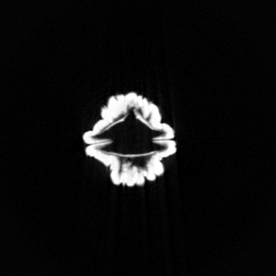

<a name="zh-cn"></a>

# ConeFDK · 单 GPU 锥束 CT 重建

**简体中文** · [English](#english)

在 NVIDIA DGX Spark（GB10）上，用 720 幅核桃 X 射线实测投影重建 **512³ 体数据**。原生 C++/CUDA 引擎完成锥束加权、cuFFT 分批滤波和按显存预算分块的反投影。Python 用来准备输入和独立校验；重建程序本身不需要 Python。

[个人主页项目详解](https://etherealbian.github.io/work/cone-fdk.html) · [Windows 稳定版 v0.1.0](https://github.com/EtherealBian/cone-fdk/releases/tag/v0.1.0) · [下载离线切片浏览器](https://github.com/EtherealBian/cone-fdk/releases/download/v0.1.0/walnut-512-viewer.html)



动图中的壳、隔膜和核仁均来自实测数据：[Alexander Meaney / 赫尔辛基大学](https://doi.org/10.5281/zenodo.6986012)，CC BY 4.0。离线浏览器可拖动查看 81 张预览切片，无需 CUDA。[数据署名与处理说明](NOTICE.md)

## DGX Spark 实测：一颗核桃，三种重建网格

| 检查 | 实测结果 | 记录 |
|---|---|---|
| 720 角、512³ 重建 | 两次原生输出逐字节相同；与 Spark 上独立运行的 ASTRA FDK 相比，全体积相对 L2 差异为 **0.02899%**，未配准或拟合强度。 | [原生重复](reports/gb10/walnut-native.json) · [ASTRA 对照](reports/gb10/walnut-astra.json) |
| 一次重建三个网格 | 整件概览加两个不同网格的局部，从读三遍投影减为一遍。六组配对中，原生进程中位耗时 **1.743 → 0.643 秒**，三个输出与分别重建逐字节相同。 | [逐次计时与口径](reports/gb10/multigrid-timing.json) |
| 断点恢复 | 进程在第 2 块写入后被强制终止。沿用原有回调补算其余 3 块，512³ 输出与整卷基线逐字节一致。 | [中断与复核记录](reports/gb10/slab-recovery.json) |
| 无 GPU 复核 | 随仓库提供另外两个实测选区的原生与 ASTRA 体素。仅用标准 Python 即可复算 **138,948 个体素**的逐层差异。 | [运行步骤](platform/spark/QUICKSTART.md) · [样例数据](examples/gb10-walnut) |
| 整颗核桃哪里相差最大？ | 512 层中，差异最大的位置首次出现在 **(367, 318, 256)**。下载两种算法在该层的原始切片，即可逐一复算 262,144 对体素。 | [逐层曲线与运行步骤](platform/spark/QUICKSTART.md#offline-physical-peak) · [批检导出记录](reports/gb10/physical-peak-snapshot.json) |

**两件实物、三种扫描条件已完成批检。** 在 256³ 网格上，松果的原生 CUDA 与 ASTRA 相对 L2 差异为：90 幅投影 **0.07314%**，720 幅投影 **0.02658%**。每组直接重建的两个局部都与整卷对应区域逐字节一致。两个角度密度来自同一颗松果；这些差异衡量求解器一致性，不是实物尺寸公差。[批检结果](reports/gb10/physical-batch-complete.json) · [离线复算三个峰值层](platform/spark/QUICKSTART.md#completed-physical-batch)。下文未注明 Spark 的旧基准，耗时均来自各自记录的历史平台。

**Spark 迁移验收：** Spark 专用测试 929 项全部通过。原有 707 项中，702 项通过，剩余 5 项要求禁止其他进程改写或替换原文件名。[测量工具构建步骤、实测结果与兼容边界](platform/spark/QUICKSTART.md#spark-migration-acceptance)。

## 换一组阈值，缺陷区域会变多少？

在带局部壁厚变化的**仿真试件**上，参考图与待检图各取三个边缘阈值。九种组合都得到一个连通区域，但覆盖范围是 **253 至 275 个网格单元**；同一试件的重复对照在九种组合下均为零。另一个无效边缘对照保留原定的四种组合，无法判定的单元单独计数。Spark 上两条原生 CUDA 路径分别重算，与封存的壁厚及分类文件逐字节相同。[不用 GPU 复算 22 张连通区域图](platform/spark/QUICKSTART.md#offline-threshold-review) · [逐组结果](reports/gb10/directory-edge-qualification.json)。

## 不生成整件，直接重建选区

用当前源码构建后，`--roi x,y,z,nx,ny,nz` 可以直接从投影重建一个长方体，例如只复查核桃壳与隔膜的交界。选区沿用原扫描的坐标和体素间距，可以与整件叠加。同一批 720 角投影实测：在 512³ 网格中重建 128 × 128 × 96 的选区，整进程中位数 **0.317 秒**，完整重建为 **1.561 秒**；六轮选区均与完整体裁剪逐字节一致。输出从 512 MiB 减至 **6 MiB**。旧版 v0.1.0 可执行文件不含此选项。

[选区位置、2048³ 网格上的独立校验、复现命令](reports/ROI.md) · [逐次耗时及文件哈希](reports/roi-walnut.json)

同一试件有多个位置要复核时，`--roi-list` 可以共用滤波后的投影。六个位置逐个重建耗时 **1.805 秒**，一次批量重建为 **0.351 秒**（六组整批中位数），投影只读一遍。每个选区与单独重建、完整体同位置裁剪逐字节一致；收紧预算后会自动分遍。[查看六个位置、显存代价和复现命令](reports/MULTI-ROI.md)。

预算紧时，可在 `--roi-list` 后加 `--planner min-passes`。同样六个位置、**48 MiB** 缓冲预算，每批从 16 个角度减至 8 个，整套投影从 **读三遍降到一遍**，整进程中位耗时 **0.590 → 0.304 秒**；六组输出均与原参考逐字节一致。默认策略不变。[不同预算的结果和复现步骤](reports/ROI-PLANNER.md)。

## 沿指定方向看截面

如果想沿着倾斜的结构往里看，用 `--plane` 指定切面中心、行列方向和像素间距即可。引擎从原始投影直接计算这一层，不需要先重建 512 MiB 的整件。核桃的一张 **320 × 288** 斜切面只输出 **360 KiB**；三个标准切面与完整体对应层逐字节一致。斜切面上分布取样的 365 点，与独立 CPU 双精度计算的相对 L2 差异为 **0.000164%**。另用已知尺寸的解析球体验证了三个截面的圆心和直径。[四张实测切片、误差口径与复现命令](reports/DIRECT-PLANES.md)。此功能需从当前源码构建。

要沿着结构连续往里看，可以用 `--stack` 重建一叠平行的斜切片，导出为带毫米坐标和方向的单个 NRRD 文件。在同一份核桃数据上，**21 层**斜切片与逐张运行的结果逐字节相同，整套投影从**读 21 遍减到 1 遍**。另用已知直径的模拟球检验了三维体积和球心。[查看斜向扫查动图、复现命令和误差](reports/OBLIQUE-STACK.md)。

## 把圆周摊开看

平面切片只能看到环形结构的局部。`--cylinder` 可以沿指定轴把完整一圈铺成图，核桃的 720 个实测投影只读一遍就得到半径 7–17 mm 的 11 张展开图。[下载离线圆柱展开台](reports/walnut-cylinder-atlas.html)：拖动半径看内外层，移动接缝追踪结构，或点击两点量同一圆柱上的最短表面距离。核桃不是规则圆柱，图层也不等同于核桃壳边界。[截图、误差和复现命令](reports/CYLINDER-ATLAS.md)。


## 找出管件哪一侧最薄

`cone-fdk wall` 沿每个高度和方位的半径找出内外界面，以毫米记录两者之间的距离。两件已知尺寸的模拟偏心管，最薄的 15° 扇区分别落在设计的 **358° 和 134°**，逐点壁厚最大误差分别为 **0.01322 mm、0.01065 mm**。给第一件加上与外管隔开的内衬后，6,120 条径向剖面全部识别为多层并拒测，不会把空气间隙算进壁厚。[看误差曲线、复核一条剖面或运行自己的扫描](reports/RADIAL-WALL.md)。这是当前源码的模拟验收，尚未用带尺寸真值的实物管件校准。

## 换个装夹位置，内外径还测得一样吗？

`cone-fdk bore` 在每个高度分别拟合内外圆，给出内外径、两个圆心的扫描坐标、偏心量和圆模型最小壁厚。对同一根管做模拟平移、旋转并重新生成投影后，原采样的外径最多变化 **0.01696 mm**；探测器间距和径向重建步长均减半时，变化降到 **0.00788 mm**，通过预设的 **0.012 mm** 门槛。单独加密重建不能让原扫描通过这项目标。[四组对照、椭圆拒测和复现命令](reports/BORE-GAUGE.md)。这是模拟结果，不是实物公差。

## 管件装斜了，能不能继续测内外径？

先用 `axis` 从外壁找出管轴，再从**同一份原始投影**重建垂直于它的截面。在 8° 和 12° 的模拟装夹中，原先每份扫描的 25 层都因斜切而拒测；找正后，25 层全部通过同一圆度门槛。计入一组带计数噪声的扫描，四组圆管的最大直径误差为 **0.0010905 mm**。外壁椭圆时不发布轴，只有内孔椭圆时仍拒报孔径。这些是对模拟设计真值的误差，不代表实物精度；找正管轴也不能确定两个缺陷是否在同一材料位置。[看找正前后曲线、六组正反例和复现命令](reports/AXIS-GAUGE.md) · [下载 CPU 复核包](reports/axis-review.zip)。

## 定位局部减薄，而不只报告最薄点

把已对齐的基准管和待测管交给 `cone-fdk loss`，会得到每处减薄的范围、面积、剩余径向壁厚，以及峰值处内外壁各变化了多少。在同一根模拟管上，外壁削平和内孔局部扩大的设计深度是 0.850、0.750 mm，测得 **0.857、0.756 mm**。削平区虽然出现在展开图的两端，仍只算一处。对完好管独立加入两份计数噪声，同一 0.30 mm 门槛下未报出区域。[检测图、带噪对照、适用边界与运行方法](reports/WALL-LOSS.md) · [下载可用 CPU 逐点复核的样包](reports/wall-loss-demo.zip)。

## 换了装夹，能不能量出同一处缺陷加深了多少？

同一根模拟管件换个角度再扫，按扫描仪网格硬比会报出 325 个超限单元。用四颗随件球标恢复材料坐标，再从原投影重建，原样复扫的 14,760 个单元里 **0 个超限**。把原有外壁平面再加工深 0.550 mm，同一法向的壁厚实测减少 **0.54796 mm**；少一颗标记则拒绝比较。[看固定网格与材料网格的对照、误差门槛及运行方法](reports/REMOUNT-LOSS.md) · [下载壁图逐点复核](reports/remount-deepened.zip)。这些数字来自模拟复扫，不是实物精度标定。

**如果四颗球一起滑了呢？** 模拟管件没有减薄，只把工装轴向滑动 0.80 mm，四球拟合残差仍只有 0.00681 mm，原流程却报出 159 个超限单元。现在可以用 `--witness` 启用管件本体上的三个独立见证点：两次扫描分别核对，任一点不通过就不生成壁图。它复用同一份 CUDA 侦察体，不额外读取投影，也不用这三个点修正位姿。[看滑移、绕点旋转和门槛附近的模拟结果](reports/BODY-WITNESS.md) · [下载三个小窗，在 CPU 上复核](reports/witness-pivot.zip)。

**换个边缘阈值，还会报减薄吗？** 带噪模拟复扫在标称设置下有 263 个单元超出 0.30 mm。让两次扫描各自选择三档边缘阈值，**253 个单元在九种组合下始终超限，22 个随设置翻转**；只试同档配对只能看到其中 1 个。直接从已配准的壳层追加 4 次 CUDA 壁厚测量，不再读投影。[看材料网格、九格读数和复现步骤](reports/EDGE-REVIEW.md) · [下载整张图，无需 GPU 逐点复核](reports/edge-review-example.zip)。这是离散设置的敏感性检查，不是实物精度或置信区间。

**整片内凹是否仍然连通？** 同一件带噪声模拟管的九组全局阈值都得到一片连通区域；在 9.4 mm 参考半径上，投影面积为 **8.301–9.023 mm²**，标称值 8.630 mm²。可以[离线复算每组面积、峰值和区域拆合](reports/REGION-REVIEW.md)，或把多件放进[支持中断续算的批检](reports/REGION-BATCH.md)，分别保留完整覆盖、不可测与拒测。

从已有壳层提取多档壁厚时，[CUDA 多档提取器](reports/WALL-PACK.md)每块只上传一次。八档中位数由 **1,219 ms 降至 180 ms**，六组配对的逐档记录完全相同；计时仅覆盖壁厚工序。

[下载离线复核台](reports/region-console.html)，可对照每组阈值与标称设置的区域交集、移动展开接缝、查看局部不可测或整件拒测。[操作说明与断网逐像素验收](reports/REGION-CONSOLE.md)。

新增两种不同壁厚的**模拟管件**，从五次分别加噪的探测器采集开始。所有九组阈值都把跨缝削平判为一处、把另一件的内外壁缺陷分成两处；无改变对照均为零处。三处峰值与设计的标称最大差为 **0.0190 mm**，所有设置的最大差为 **0.0432 mm**。[逐缺陷结果、门槛和复跑方法](reports/MULTI-SPECIMEN.md) · [下载试件离线图](reports/specimen-console.html)。这些是仿真结果，不是实物公差。

[临界窄桥挑战](reports/BRIDGE-STUDY.md)：两次独立带噪复检中，缺陷两瓣各有 3/9 种配对连通、6/9 种断开。标称足迹 IoU 均高于 0.98，但不能据此声称连通关系稳定。[下载 36 张离线图](reports/bridge-console.html)。

[长轴分带复核](reports/STRIPED-REVIEW.md)无需保留整张标签图，即可统计连通片并判断两处缺陷是否相连。1,536 × 960 的合成壁图、九组阈值共 1,327 万个配对单元，按 8 行分带时进程峰值约 61 MiB。对较小地图还可以[导出两点间的盲区路径证书](reports/ANCHOR-AUDIT.md)。 多件作业可用[可恢复批检](reports/STRIPED-BATCH.md)；重启时重新核对源文件，已提交的件不再重复标记。

要追查具体哪几格构成一片缺陷，可下载[CUDA 标签包，用 CPU 离线逐格复核](reports/PERIODIC-LABELS.md)。示例保留了跨缝连接，以及因盲区而无法判断的情形。
如果争议只在一处，可直接移交[选区证据](reports/PERIODIC-ROI.md)：跨 359/0 列的 36 格保留同一全图编号，接收方只需标准 Python。

[带见证检查的 CUDA 合包路径](reports/PACKED-EDGE.md)现在可直接从已验收的壳层生成一份完整边缘作业。计入来源校验、CUDA 进程、写盘和报告发布后，三档耗时 **690 → 445 ms**，九档 **2,564 → 644 ms**；逐档输出与原路径一致。此处不含投影重建时间。

## 扩展实验：在金属 CT 中逐孔测量

[孔隙测量分支](https://github.com/EtherealBian/cone-fdk/tree/measurement-lab/pores)的输入是已重建的钴铬合金 CT。给定掩膜，CUDA 程序能逐孔计算体积、等效直径和质心。从灰度中自动找准孔边界则仍有误差：候选 E 在 2、3、5 号开发试件分别通过 **10/11、6/11、7/11** 项，最差试件的匹配孔体积误差 P95 为 **28.16%**，门槛为 **15%**。4、6 号保留件未启用；该实验不包含在稳定发布包内。

[三件结果与原始档重放](https://github.com/EtherealBian/cone-fdk/blob/7b9d4bfc9c1ea8fe2750baa1a2b8154bfd09b418/pores/RETAINED-BASELINE.md) · [看同一切片上两个孔如何被连成一个](https://etherealbian.github.io/work/cone-fdk.html#pore-pair) · [四件外部试件的不同数字边界](https://github.com/EtherealBian/cone-fdk/blob/7b9d4bfc9c1ea8fe2750baa1a2b8154bfd09b418/pores/EXTERNAL-REFERENCE-AGREEMENT.md)

## 从源码运行

在 DGX Spark 上，按 [Spark 原生 CUDA 构建与运行步骤](platform/spark/QUICKSTART.md#run-native-cuda-from-a-fresh-source-checkout) 从源码运行。下面的 PowerShell 命令用于 Windows。

```powershell
git clone https://github.com/EtherealBian/cone-fdk.git
cd cone-fdk
# 按下节安装锁定依赖；在 x64 编译器环境中先从源码构建
.\Build.ps1
.\Demo.ps1                 # 离线：90 个实测角，原生 / ASTRA 对照，输出阅片器和 MetaImage
.\Run-Acceptance.ps1       # 重编译 + 回归 + 精度 + 性能 + 超显存 + 全部 720 个实测角
```

演示输出 `reports/walnut-viewer.html` 可直接在浏览器打开，无网络服务；`data/walnut-corrected-256.mhd` 和同目录 `.f32` 是保留定量信息的完整体。全量测试另外生成 `data/full-corrected-512.mhd`、对应 `.f32` 和 `reports/full/walnut-viewer.html`。HTML 内置 81 张固定显示窗的轴向预览，不是全部切面，也不应用来量灰度。

## 从发布包到新环境

Windows x64、支持 compute_80 PTX 和 CUDA 12.9 PTX JIT 的 NVIDIA GPU/驱动。发布包附已编译的 EXE/PTX，**不附第三方 DLL、Python、自称可用的模拟 GPU 或扫描仪**。使用 Python 3.12 x64，并允许从 Python 包源安装锁定的依赖。若需重编译，准备 x64 MSVC Developer PowerShell 或 MinGW-w64；本次测试使用 MinGW。本机还验证了两次从源重编所得 EXE/PTX 的 SHA-256 一致，见 [构建记录](reports/build-repro.json)；不同编译器或驱动未作这种承诺。验证已解压文件：`Get-FileHash` 可对照随包的 `SHA256SUMS`，或运行 `py -3.12 scripts/release.py verify .`。

```powershell
py -3.12 -m venv .venv
.\.venv\Scripts\python.exe -m pip install -r requirements-win.lock
.\Demo.ps1
.\Run-Acceptance.ps1 -SkipBuild            # 验证交付的二进制
.\Run-Acceptance.ps1 -CoreOnly -SkipBuild  # 较短；跳过超显存与全角测试
```

默认完整验收需要按 Zenodo 记录下载约 4.24 GB 原始归档，已有归档会核验 MD5 并复用；建议预留 **25 GiB** 可用磁盘。`1296³` 压力测试的临时原始体核验后删除。该固定尺寸用例特意断言输出大于本机物理显存，换到显存更大的 GPU 不能原样证明“超显存”，应调整压力体和取样几何。WDDM 遥测基于本地 Windows 显示驱动栈，其他系统、卡型与工具链不在这次验收范围。

如需自行打包：完成全量验收，并按 [A/B 复现步骤](reports/OPTIMIZATION.md) 生成本次二进制的性能与跨版本输出记录；用 `.\Build.ps1 -VerifyRepeat` 自动双编并记录二进制指纹（只有指纹一致才通过）。运行 `python scripts/release.py build`，再用同一验收环境运行 `python scripts/check_release.py dist/ConeFDK-win-x64.zip`。后者在临时中文路径内校验全部成员，删掉已有演示图，重新从随包投影生成体数据并逐张校验 81 张 PNG。结果写到包旁的 `verification.json`。

## 自有扫描如何接入

`scan.geom` 是单行 ASCII，依次为标记、视角数、探测器行/列数、U/V 像素间距、源到等中心距离、源到探测器距离、起始角（弧度）、旋转符号（±1）。例：

```text
CFDK1 720 296 280 0.4 0.4 210.66 553.74 0 1
```

`scan.f32` 是小端 float32 的**线积分**（不是未校正强度），连续布局 `[角度,v,u]`，索引 `u` 最快。只接受完整均匀圆轨迹，第 `i` 角为 `start + sign * 2πi/views`；不要把 360° 终点重复输入。输出 `[z,y,x]`，每轴 `n`，体素中心位置 `(index-(n-1)/2)*fov/n`。距离与 FOV 用 mm，输出衰减用 mm⁻¹。包装器仅把 wheel 的 CUDA DLL 路径加入子进程环境；独立运行 EXE 时让 CUDA 12 的 cuFFT 及其依赖可被 Windows 加载器找到。

```powershell
# 在已运行 Demo 的目录；不加 --astra 默认执行自研 EXE
.\.venv\Scripts\python.exe scripts/reconstruct.py data/walnut-corrected data/my-volume.f32 --n 384 --fov 40 --budget 512 --batch 16
# 已配置 NVIDIA DLL 路径的独立终端，同一工作不需要 Python
.\build\cone-fdk.exe --ptx build/kernels.ptx --geom data/walnut-corrected.geom --input data/walnut-corrected.f32 --output data/my-volume.f32 --n 384 --fov 40 --budget 512 --batch 16
```

CLI 成功时 stdout 输出 JSON；失败返回非零并将错误写入 stderr。校验长度、几何、有限性和路径别名；同目录临时文件完整写入并 flush、显存边界校验后才替换目的文件。显存预算单位 MiB，不等于整个进程或驱动的峰值。`--host-memory auto`（默认）分别尝试锁页输入和输出暂存区，每块上限 8 MiB；超过上限或锁页内存不足时使用普通主机内存。`--host-memory pageable` 禁用锁页。`host_pinned_bytes` 单列实际锁页主机字节，不计入设备缓冲峰值。

## 哪些部分值得读

| 路径 | 解决的问题 |
|---|---|
| `src/kernels.cu` | 先乘 `DSD/sqrt(DSD²+u²+v²)`；U 方向零填充到至少两倍探测器宽度，按离散 Ram-Lak 滤波。以体素为中心双线性采样；探测器外零延拓。每线程算 16 个相邻 Z，保留原四层组的坐标舍入顺序。用已释放使用权的 FFT 缓冲暂存水平插值系数；两侧零哨兵维持零延拓。 |
| `src/main.cpp`、`src/gpu.hpp` | 按预算规划角度批与 Z 分块，显式管理 cuFFT 工作区。分块复用缓冲，保持视角累加次序，每个 slab 付出重读重滤的代价；含 CUDA Event 计时、边界哨兵与占用计数。 |
| `src/files.hpp` | Windows Unicode 文件、身份别名检测、大体积分段写出及事务式发布。 |
| `tests/test_spatial_oracle.py` | 小体积独立 FP64 空间域参考：直接卷积而非 FFT，用射线与平面的交点逐体素核验 GPU 实现。 |
| `scripts/phantom.py`、`scripts/accept.py` | 用解析射线与有限圆柱/球相交生成独立真值；核验孔位、孔径、衰减、离面夹杂及全体积误差。 |
| `scripts/full_walnut.py`、`scripts/prepare_walnut.py` | 按原始元数据构造真实几何。原始投影已校正暗场/平场；每帧原图左上 128×128 算空气基准，水平循环左移 5 原始像素，8×8 强度均值后取负对数。另保留未移位的对照。 |
| `scripts/benchmark.py`、`scripts/stress.py` | 新进程交替测本机 GPU 与 ASTRA；压力测试真正落盘超显存体并跨接缝用 ASTRA 独立核查五层。 |

## 适用边界

这是面向工业 CT 算法与 GPU 工程的可复现原型，**不是经过计量检定的工业检测设备或医疗软件**。仅支持居中、平板、等角间隔的单圈锥束。默认整件输出为各向同性立方体；定向切片和层栈可分别指定各轴间距。圆轨迹 FDK 在离中平面处是近似；没有螺旋、短扫描/Parker、散射与硬化校正、金属伪影消除或实际缺陷检出认证。512³ 网格间距不等于系统真实空间分辨率；与 ASTRA 一致也不代表实物尺寸真值。许可证、数据署名及变换说明见 [NOTICE](NOTICE.md)。

---

## English

[简体中文](#zh-cn) · **English**

**ConeFDK · Single-GPU cone-beam CT**

ConeFDK turns 720 measured X-ray projections of a walnut into a **512³ volume** on an NVIDIA DGX Spark (GB10). The C++/CUDA engine weights each projection, filters detector rows with cuFFT, and backprojects into slabs that fit the GPU memory budget. Python prepares the input and checks the output; the native executable runs without it.

[Project walkthrough](https://etherealbian.github.io/work/cone-fdk.html) · [Windows release v0.1.0](https://github.com/EtherealBian/cone-fdk/releases/tag/v0.1.0) · [Download the offline slice viewer](https://github.com/EtherealBian/cone-fdk/releases/download/v0.1.0/walnut-512-viewer.html)


*The image is a sweep through measured data, not a rendering of a synthetic walnut. The downloadable HTML lets you scrub 81 preview slices without installing CUDA. Data: [Alexander Meaney / University of Helsinki](https://doi.org/10.5281/zenodo.6986012), CC BY 4.0; processing and attribution in [NOTICE](NOTICE.md).*

### Measured on DGX Spark: one walnut, three reconstruction grids

| Check | Result | Evidence |
|---|---|---|
| 720 views, 512³ reconstruction | Two native runs produced identical bytes. Against a separate ASTRA FDK run on Spark, full-volume relative L2 was **0.02899%**, without registration or intensity fitting. | [Native repeats](reports/gb10/walnut-native.json) · [ASTRA comparison](reports/gb10/walnut-astra.json) |
| One projection pass for three grids | A full overview and two finer regions took **1.743 → 0.643 s** median native process time over six pairs. Each output matched its standalone reconstruction byte-for-byte. | [Paired trials and timing boundary](reports/gb10/multigrid-timing.json) |
| Resume after a process kill | On the 720-view walnut, two committed slabs were reused and three were computed after restart. All **512 MiB** matched the uninterrupted reconstruction byte-for-byte. | [Recovery receipt](reports/gb10/slab-recovery.json) |
| Review without a GPU | Two additional measured regions ship with both native and ASTRA voxels. Recompute the per-plane differences across **138,948 voxels** using standard Python. | [Quickstart](platform/spark/QUICKSTART.md) · [Sample data](examples/gb10-walnut) |
| Where do the two solvers differ most? | Across 512 axial planes, the first maximum is at **(367, 318, 256)**. The offline snapshot includes both raw peak slices: remeasure all 262,144 pairs without a GPU. | [Peak profile and reproduction](platform/spark/QUICKSTART.md#offline-physical-peak) · [Queue export checks](reports/gb10/physical-peak-snapshot.json) |

**Two physical specimens, three scan conditions.** The completed batch adds a pine cone reconstructed on a 256³ grid: native versus ASTRA relative L2 **0.07314% at 90 views** and **0.02658% at 720 views**. Two direct native crops per condition matched their dense counterparts byte-for-byte. The view counts describe one pine cone; neither solver supplies physical dimensional truth. [Final batch](reports/gb10/physical-batch-complete.json) · [Recheck all three peak planes without a GPU](platform/spark/QUICKSTART.md#completed-physical-batch). Unless explicitly labeled Spark, benchmarks below retain their historical platforms and timings.

**Spark migration:** 929 Spark tests passed. Of the same 707 historical cases, 702 pass; five require original-path write or rename denial. [Build the measurement tools and review exactly what passed](platform/spark/QUICKSTART.md#spark-migration-acceptance).

### How sensitive is a wall-loss footprint to its edge threshold?

In a **simulated** changed specimen, all nine reference/inspection threshold pairs found one connected region, but its footprint ranged from **253 to 275 cells**. The repeat control found none. A separate invalid-edge control retains its original four pairs and marks unknown cells explicitly. Two native CUDA backends on Spark reproduced the archived wall and classification files byte-for-byte. [Recompute the 22 cylindrical label grids without a GPU](platform/spark/QUICKSTART.md#offline-threshold-review) · [Pair-by-pair results](reports/gb10/directory-edge-qualification.json).

### Reconstruct just the region you need

From a **source build**, `--roi x,y,z,nx,ny,nz` backprojects a box directly from the original projections. Its coordinates and voxel pitch belong to the full scan. On the same 720 walnut views, a 128 × 128 × 96 box took **0.317 s** versus **1.561 s** for the 512³ parent (six warm pairs; every box matched the corresponding parent bytes). The output was **6 MiB** instead of 512 MiB. The original v0.1.0 executable does not implement this option.

[See the selected region, the 2048-grid ASTRA check and runnable commands](reports/ROI.md) · [All timings and hashes](reports/roi-walnut.json)

For several locations in one scan, `--roi-list` shares each filtered projection batch across the resident boxes. In the archived Windows benchmark, six independently launched regions took **1.805 s** in total versus **0.351 s** as one job (six paired trials, 6/6 faster). All six regions matched both the individual jobs and crops of the published 512³ reference byte-for-byte. [Six locations, timing, memory trade-off and commands](reports/MULTI-ROI.md).

If the boxes no longer fit together, add `--planner min-passes`. With the same six regions and a **48 MiB** buffer budget, using 8 views per batch instead of 16 reduced full projection reads **3 → 1** and median process time **0.590 → 0.304 s**, with identical output bytes in all six pairs. The default policy is unchanged. [Budget sweep and reproduction](reports/ROI-PLANNER.md).

### Inspect an oblique cross-section

Use `--plane` to reconstruct a single image at a specified position, orientation and pixel spacing, directly from the projections. A tilted **320 × 288** cut through the walnut writes **360 KiB** without materializing the 512 MiB parent. Three standard cuts matched their parent slices byte-for-byte; on the tilted cut, 365 sampled intensities agreed with an independent FP64 calculation to **1.64 × 10⁻⁶ relative L2**. [See the four cuts, the separate analytic sphere measurements and a runnable example](reports/DIRECT-PLANES.md). Available from a source build.

To follow that structure in depth, `--stack` reconstructs **parallel, evenly spaced cuts** in one job and writes a raw array or a single NRRD with its scanner-space orientation in millimetres. On the walnut, all **21 tilted slices** matched separate plane jobs byte-for-byte while reading the projections **once instead of 21 times**. [Watch the tilted sweep, reproduce the stack, and see the known-sphere volume check](reports/OBLIQUE-STACK.md).

### Unwrap a cylinder through the scan

A flat slice cuts a ring twice. `--cylinder` follows the ring for a full turn instead. On the measured walnut, 11 radii from 7 to 17 mm share one read of the 720 projections. In the [offline atlas](reports/walnut-cylinder-atlas.html), change radius, move the seam, or click two points to measure the shortest path **on that cylinder**, including across the image edges. [Screenshot, coordinate convention, accuracy checks and CLI](reports/CYLINDER-ATLAS.md).


### Find the thin side of a tube

`cone-fdk wall` measures the inner radius, outer radius and **radial wall thickness** at each azimuth and height of a cylindrical reconstruction. On two simulated eccentric bores, the thinnest 15° sectors landed at the designed **358° and 134°**. Maximum pointwise thickness errors were **0.01322 mm and 0.01065 mm**. Adding a separated liner made every ray cross two walls; the engine rejected all 6,120 instead of reporting a spurious thickness. [Results, raw profile evidence and reproduction](reports/RADIAL-WALL.md). These are simulation results, not accuracy claims for a physical pipe. Available from a source build.

### Measure bore diameter and eccentricity after repositioning

`cone-fdk bore` fits an inner and outer circle independently at each height of a wall map. It reports both diameters, their centers in scanner coordinates, and the minimum gap between the fitted circles. In a simulated remount, the maximum change in outer diameter was **0.01696 mm** at the original sampling and **0.00788 mm** with both detector and radial pitches halved (gate: 0.012 mm). The latter needs new, finer projections; it is not a software-only improvement to an existing scan. [Compare all four settings, inspect a rejected ellipse, and run the gauge](reports/BORE-GAUGE.md).

### Gauge a tube mounted at an angle

A circular tube cut in the wrong plane looks elliptical. The source-build `axis` workflow estimates the outer centerline, then reconstructs **again from the original projections**, perpendicular to that line. On the 8° and 12° simulated mounts, the unchanged circle gauge went from **0/25 to 25/25 accepted sections per scan**. Across four circular cases including one with counting noise, maximum diameter error was **0.0010905 mm** against design. An oval outer wall stopped the workflow; an oval bore on a round outer wall still failed the bore gauge. This locates a line, not a material landmark for aligning loss maps. [Before/after profiles, limits and commands](reports/AXIS-GAUGE.md) · [CPU-checkable example](reports/axis-review.zip).

### Locate local wall loss, including across the unwrap seam

Given a registered baseline and inspected tube, `cone-fdk loss` reports **where material was lost**: the footprint, maximum loss, remaining radial wall, and the separate inner/outer changes at its peak. In a simulated tube with an outside flat and an inside relief, their peak losses measured **0.857 and 0.756 mm** against designs of 0.850 and 0.750 mm. The outside flat appears at both ends of the unwrapped image but counts only once. A separately noise-sampled pristine pair produced zero regions at the same 0.30 mm threshold. [See the footprints, noise cases, limits and commands](reports/WALL-LOSS.md) · [Download a compact sample for CPU-only review](reports/wall-loss-demo.zip).

### Reinspect the same defect after a remount

An unchanged simulated tube produced 325 falsely flagged cells when compared in scanner coordinates. Registering four fixture beads and reconstructing each scan in **material coordinates** brought that count to **0 of 14,760**. When an existing outside flat was cut another 0.550 mm deeper, the wall thickness along its normal decreased by **0.54796 mm**. A missing bead suppressed the comparison. [See the maps, pose errors, noise controls and commands](reports/REMOUNT-LOSS.md) · [Replay an individual cell without CUDA](reports/remount-deepened.zip). The fixture must be calibrated and rigidly attached; this is not markerless registration or physical metrology validation.

**What if the four beads slip together?** With an unchanged simulated tube, a 0.80 mm carrier slide still fit the four beads to 0.00681 mm and produced 159 false loss cells. With `--witness`, three independent inserts in the workpiece vetoed that comparison **before either wall map was written**. They use the existing CUDA scout, not another projection pass or a correction to the fitted pose. [Slip and pivot controls, decision limits and commands](reports/BODY-WITNESS.md) · [Inspect the three raw windows without CUDA](reports/witness-pivot.zip).

**Does a loss decision survive a change in edge level?** On the noisy simulated remount, 263 material cells exceeded the 0.30 mm loss gate at the nominal edge level. Across three edge levels selected independently in each scan, **253 always exceeded it and 22 changed decision** (10 originally flagged, 12 originally below). Testing only matched levels exposed just one of those 22. The review reuses both registered shells: four additional CUDA wall measurements, no new projection pass. [Decision map, nine-pair example and commands](reports/EDGE-REVIEW.md) · [Full grid for CPU-only replay](reports/edge-review-example.zip). This is a finite scenario check, not a confidence interval.

**Does the entire footprint survive the same setting?** On that remount, all nine global level pairs produced one connected region. Its projected area ranged from **8.301 to 9.023 mm²** at a 9.4 mm datum radius (nominal: 8.630 mm²). Periodic labels, split/merge overlaps and missing coverage can be [replayed offline](reports/REGION-REVIEW.md). A [resumable batch inspector](reports/REGION-BATCH.md) keeps measured, incomplete and refused jobs separate.

When extracting several wall levels from an existing shell atlas, the [CUDA wall pack](reports/WALL-PACK.md) uploads each tile once. Eight levels took **180 ms instead of 1,219 ms**, with byte-identical per-level records (six paired runs; wall stage only).

[Download the offline inspection console](reports/region-console.html) to select a threshold pair, move the cylindrical seam and see how regions overlap the nominal setting. The [browser check](reports/REGION-CONSOLE.md) compares the actual displayed pixels with native CUDA output, including missing coverage and withheld results.

Two additional **simulated tube geometries** were inspected from five separately noise-sampled acquisitions. All nine threshold pairs kept the seam-spanning flat connected, separated the two defects on the other tube, and returned zero regions on the unchanged control. The largest peak deviation from design was **0.0190 mm at nominal settings**, or **0.0432 mm over all settings**. [Per-defect footprints, gates and replay](reports/MULTI-SPECIMEN.md) · [Offline inspection](reports/specimen-console.html). These are not tolerances measured on physical tubes.

The [preregistered narrow-bridge study](reports/BRIDGE-STUDY.md) shows why a high footprint IoU does not guarantee a stable component count: each critical acquisition linked the two lobes under only three of nine global edge settings. [Offline maps](reports/bridge-console.html).

[Long-grid review](reports/STRIPED-REVIEW.md) summarizes connected defects and the relationship between two material locations without a full label map. On a 1,536 × 960 synthetic wall grid, nine global settings covered 13.27 million pair-cells in about 61 MiB of process working set with eight-row bands. The [offline path audit](reports/ANCHOR-AUDIT.md) can also show exactly where a smaller map needs evidence. The [resumable batch workflow](reports/STRIPED-BATCH.md) revalidates source bytes before it reuses a completed specimen.

Need to see which cells form a defect? The [CUDA label exporter and CPU-only parcel verifier](reports/PERIODIC-LABELS.md) preserve the component ID of each measured cell, including across the seam. Download a linked example and a genuinely unresolved one.
For a handoff limited to one disputed location, use a [detached ROI receipt](reports/PERIODIC-ROI.md). The seam example preserves the same global ID across column 359/0; the recipient needs only standard Python.

The optional [witness-guarded CUDA path](reports/PACKED-EDGE.md) now publishes a complete edge-review job from retained shells. On the same accepted parent, three edge levels took **690 → 445 ms** and nine took **2,564 → 644 ms**, including source checks, CUDA processes and output publication; every map matched the original producer. These are edge-review times, not reconstruction times.

### A second use: measuring pores in metal

The [measurement lab](https://github.com/EtherealBian/cone-fdk/tree/measurement-lab/pores) starts from **already reconstructed** cobalt-chromium scans. Its CUDA counter measures connected pores in a supplied binary mask. Finding the pore boundary from grayscale is a separate experiment: on development specimens 2, 3 and 5, the retained model E passed **10/11, 6/11 and 7/11** criteria. Its worst matched-pore volume error (P95) was **28.16%**, above the **15%** limit. The two reserved specimens remain unopened. This work is not part of the stable reconstruction release.

[Compare the three specimens and replay E](https://github.com/EtherealBian/cone-fdk/blob/7b9d4bfc9c1ea8fe2750baa1a2b8154bfd09b418/pores/RETAINED-BASELINE.md) · [Inspect a pore in the source slices](https://etherealbian.github.io/work/cone-fdk.html#pore-pair) · [Compare digital boundaries from four external specimens](https://github.com/EtherealBian/cone-fdk/blob/7b9d4bfc9c1ea8fe2750baa1a2b8154bfd09b418/pores/EXTERNAL-REFERENCE-AGREEMENT.md)

### Try it

- **Build and run on DGX Spark:** follow the [native CUDA quickstart](platform/spark/QUICKSTART.md#run-native-cuda-from-a-fresh-source-checkout).
- **Just inspect the result:** download the HTML viewer above and open it in a browser. No installation or network connection required to view the slices.
- **Run the offline 90-view demo:** extract `ConeFDK-win-x64.zip` from the release. In that directory run the commands below on a compatible Windows x64 NVIDIA machine. The release includes the executable, PTX and measured fixture, not NVIDIA DLLs. Installing dependencies requires internet access.

```powershell
py -3.12 -m venv .venv
.\.venv\Scripts\python.exe -m pip install -r requirements-win.lock
.\Demo.ps1
```

- **Build from a source clone:** install the same locked dependencies, open an x64 MSVC Developer PowerShell (or set `CXX` to a 64-bit MinGW compiler), then run `.\Build.ps1` before `.\Demo.ps1`. `.\Run-Acceptance.ps1` also exercises the 720-view dataset and the disk-backed stress case. Allow about 25 GiB free. See the [input contract and CLI examples (in Chinese)](#自有扫描如何接入).
- **Reproduce the optimization comparison:** the release includes a compact `ConeFDK-ab-baseline.zip` with the previous native executable, PTX, source and reference output hashes. See [benchmark protocol](reports/OPTIMIZATION.md). Its wrapper is a new ZIP, not the archived full development release; the native binary hashes match the original benchmark.

### Where the engineering is

| Read | Why |
|---|---|
| [CUDA kernels](src/kernels.cu) | Voxel-driven backprojection, Z-register tiling and interpolation coefficients packed into the former FFT scratch region. |
| [Memory planner and runtime](src/main.cpp) | Selects angle batches and Z slabs under a byte budget. Smaller budgets trade rereading/refiltering for lower residency. |
| [Windows file I/O](src/files.hpp) | Unicode paths, input/output alias checks, and transactional publishing after successful validation and flush. |
| [FP64 spatial oracle](tests/test_spatial_oracle.py) · [Acceptance gates](reports/ACCEPTANCE.md) | Direct convolution and independently constructed projection geometry, alongside analytic phantoms and real data. |

**Scope:** centered, circular, full-scan cone-beam geometry with a flat detector. Experimental reconstruction software, not a calibrated industrial inspection system or clinical device. Agreement with ASTRA is not dimensional ground truth. The reported memory budget excludes driver/context allocations. No claim that Compute Sanitizer passed; its attachment limitation is documented in the [test report](reports/RESULTS.md).

Original code: [MIT](LICENSE). Data and external tools retain their own licenses; see [NOTICE](NOTICE.md).
