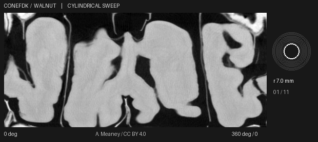

# ConeFDK · Single-GPU cone-beam CT

ConeFDK turns 720 measured X-ray projections of a walnut into a **512³ volume** on a Windows laptop. The C++/CUDA engine weights each projection, filters detector rows with cuFFT, and backprojects into slabs that fit the GPU memory budget. Python prepares the input and checks the output; the native executable runs without it.

[中文](README.zh-CN.md) · [Project walkthrough](https://etherealbian.github.io/work/cone-fdk.html) · [Windows release v0.1.0](https://github.com/EtherealBian/cone-fdk/releases/tag/v0.1.0) · [Download the offline slice viewer](https://github.com/EtherealBian/cone-fdk/releases/download/v0.1.0/walnut-512-viewer.html)


*The image is a sweep through measured data, not a rendering of a synthetic walnut. The downloadable HTML lets you scrub 81 preview slices without installing CUDA. Data: [Alexander Meaney / University of Helsinki](https://doi.org/10.5281/zenodo.6986012), CC BY 4.0; processing and attribution in [NOTICE](NOTICE.md).*

## What was measured

| Question | Result on one RTX 5060 Laptop GPU | Evidence |
|---|---|---|
| Does the reconstruction agree with an independent implementation? | 720 measured views, 8×8 detector binning, 512³ FP32 output. Full-volume relative L2 difference from ASTRA FDK: **0.02899%**. No registration or fitted intensity scale. | [Numerical checks](reports/RESULTS.md) |
| Did the optimization help the whole application? | Median process time **2.392 → 2.009 s**, including startup and output flush (−16.0%); 6/6 paired runs faster, identical output bytes. Compared with the previous native engine, **not** ASTRA. | [All A/B trials](reports/native-ab.json) |
| Can it reconstruct a volume larger than VRAM? | Wrote and hashed a **1,296³ FP32** volume (8,707,129,344 bytes) with a **512 MiB engine-owned device-buffer budget**. Five slices checked against ASTRA; not a full-volume cross-check at this size. | [Stress record](reports/oversize.json) |

## Reconstruct just the region you need

From a **source build**, `--roi x,y,z,nx,ny,nz` backprojects a box directly from the original projections. Its coordinates and voxel pitch belong to the full scan. On the same 720 walnut views, a 128 × 128 × 96 box took **0.317 s** versus **1.561 s** for the 512³ parent (six warm pairs; every box matched the corresponding parent bytes). The output was **6 MiB** instead of 512 MiB. The original v0.1.0 executable does not implement this option.

[See the selected region, the 2048-grid ASTRA check and runnable commands](reports/ROI.md) · [All timings and hashes](reports/roi-walnut.json)

For several locations in one scan, `--roi-list` shares each filtered projection batch across the resident boxes. On the same RTX 5060 Laptop, six independently launched regions took **1.805 s** in total versus **0.351 s** as one job (six paired trials, 6/6 faster). All six regions matched both the individual jobs and crops of the published 512³ reference byte-for-byte. [Six locations, timing, memory trade-off and commands](reports/MULTI-ROI.md).

If the boxes no longer fit together, add `--planner min-passes`. With the same six regions and a **48 MiB** buffer budget, using 8 views per batch instead of 16 reduced full projection reads **3 → 1** and median process time **0.590 → 0.304 s**, with identical output bytes in all six pairs. The default policy is unchanged. [Budget sweep and reproduction](reports/ROI-PLANNER.md).

## Inspect an oblique cross-section

Use `--plane` to reconstruct a single image at a specified position, orientation and pixel spacing, directly from the projections. A tilted **320 × 288** cut through the walnut writes **360 KiB** without materializing the 512 MiB parent. Three standard cuts matched their parent slices byte-for-byte; on the tilted cut, 365 sampled intensities agreed with an independent FP64 calculation to **1.64 × 10⁻⁶ relative L2**. [See the four cuts, the separate analytic sphere measurements and a runnable example](reports/DIRECT-PLANES.md). Available from a source build.

To follow that structure in depth, `--stack` reconstructs **parallel, evenly spaced cuts** in one job and writes a raw array or a single NRRD with its scanner-space orientation in millimetres. On the walnut, all **21 tilted slices** matched separate plane jobs byte-for-byte while reading the projections **once instead of 21 times**. [Watch the tilted sweep, reproduce the stack, and see the known-sphere volume check](reports/OBLIQUE-STACK.md).

## Unwrap a cylinder through the scan

A flat slice cuts a ring twice. `--cylinder` follows the ring for a full turn instead. On the measured walnut, 11 radii from 7 to 17 mm share one read of the 720 projections. In the [offline atlas](reports/walnut-cylinder-atlas.html), change radius, move the seam, or click two points to measure the shortest path **on that cylinder**, including across the image edges. [Screenshot, coordinate convention, accuracy checks and CLI](reports/CYLINDER-ATLAS.md).



## Find the thin side of a tube

`cone-fdk wall` measures the inner radius, outer radius and **radial wall thickness** at each azimuth and height of a cylindrical reconstruction. On two simulated eccentric bores, the thinnest 15° sectors landed at the designed **358° and 134°**. Maximum pointwise thickness errors were **0.01322 mm and 0.01065 mm**. Adding a separated liner made every ray cross two walls; the engine rejected all 6,120 instead of reporting a spurious thickness. [Results, raw profile evidence and reproduction](reports/RADIAL-WALL.md). These are simulation results, not accuracy claims for a physical pipe. Available from a source build.

## Measure bore diameter and eccentricity after repositioning

`cone-fdk bore` fits an inner and outer circle independently at each height of a wall map. It reports both diameters, their centers in scanner coordinates, and the minimum gap between the fitted circles. In a simulated remount, the maximum change in outer diameter was **0.01696 mm** at the original sampling and **0.00788 mm** with both detector and radial pitches halved (gate: 0.012 mm). The latter needs new, finer projections; it is not a software-only improvement to an existing scan. [Compare all four settings, inspect a rejected ellipse, and run the gauge](reports/BORE-GAUGE.md).

## Gauge a tube mounted at an angle

A circular tube cut in the wrong plane looks elliptical. The source-build `axis` workflow estimates the outer centerline, then reconstructs **again from the original projections**, perpendicular to that line. On the 8° and 12° simulated mounts, the unchanged circle gauge went from **0/25 to 25/25 accepted sections per scan**. Across four circular cases including one with counting noise, maximum diameter error was **0.0010905 mm** against design. An oval outer wall stopped the workflow; an oval bore on a round outer wall still failed the bore gauge. This locates a line, not a material landmark for aligning loss maps. [Before/after profiles, limits and commands](reports/AXIS-GAUGE.md) · [CPU-checkable example](reports/axis-review.zip).

## Locate local wall loss, including across the unwrap seam

Given a registered baseline and inspected tube, `cone-fdk loss` reports **where material was lost**: the footprint, maximum loss, remaining radial wall, and the separate inner/outer changes at its peak. In a simulated tube with an outside flat and an inside relief, their peak losses measured **0.857 and 0.756 mm** against designs of 0.850 and 0.750 mm. The outside flat appears at both ends of the unwrapped image but counts only once. A separately noise-sampled pristine pair produced zero regions at the same 0.30 mm threshold. [See the footprints, noise cases, limits and commands](reports/WALL-LOSS.md) · [Download a compact sample for CPU-only review](reports/wall-loss-demo.zip).

## Reinspect the same defect after a remount

An unchanged simulated tube produced 325 falsely flagged cells when compared in scanner coordinates. Registering four fixture beads and reconstructing each scan in **material coordinates** brought that count to **0 of 14,760**. When an existing outside flat was cut another 0.550 mm deeper, the wall thickness along its normal decreased by **0.54796 mm**. A missing bead suppressed the comparison. [See the maps, pose errors, noise controls and commands](reports/REMOUNT-LOSS.md) · [Replay an individual cell without CUDA](reports/remount-deepened.zip). The fixture must be calibrated and rigidly attached; this is not markerless registration or physical metrology validation.

**What if the four beads slip together?** With an unchanged simulated tube, a 0.80 mm carrier slide still fit the four beads to 0.00681 mm and produced 159 false loss cells. With `--witness`, three independent inserts in the workpiece vetoed that comparison **before either wall map was written**. They use the existing CUDA scout, not another projection pass or a correction to the fitted pose. [Slip and pivot controls, decision limits and commands](reports/BODY-WITNESS.md) · [Inspect the three raw windows without CUDA](reports/witness-pivot.zip).

**Does a loss decision survive a change in edge level?** On the noisy simulated remount, 263 material cells exceeded the 0.30 mm loss gate at the nominal edge level. Across three edge levels selected independently in each scan, **253 always exceeded it and 22 changed decision** (10 originally flagged, 12 originally below). Testing only matched levels exposed just one of those 22. The review reuses both registered shells: four additional CUDA wall measurements, no new projection pass. [Decision map, nine-pair example and commands](reports/EDGE-REVIEW.md) · [Full grid for CPU-only replay](reports/edge-review-example.zip). This is a finite scenario check, not a confidence interval.

**Does the entire footprint survive the same setting?** On that remount, all nine global level pairs produced one connected region. Its projected area ranged from **8.301 to 9.023 mm²** at a 9.4 mm datum radius (nominal: 8.630 mm²). Periodic labels, split/merge overlaps and missing coverage can be [replayed offline](reports/REGION-REVIEW.md). A [resumable batch inspector](reports/REGION-BATCH.md) keeps measured, incomplete and refused jobs separate.

When extracting several wall levels from an existing shell atlas, the [CUDA wall pack](reports/WALL-PACK.md) uploads each tile once. Eight levels took **180 ms instead of 1,219 ms**, with byte-identical per-level records (six paired runs; wall stage only).

[Download the offline inspection console](reports/region-console.html) to select a threshold pair, move the cylindrical seam and see how regions overlap the nominal setting. The [browser check](reports/REGION-CONSOLE.md) compares the actual displayed pixels with native CUDA output, including missing coverage and withheld results.

Two additional **simulated tube geometries** were inspected from five separately noise-sampled acquisitions. All nine threshold pairs kept the seam-spanning flat connected, separated the two defects on the other tube, and returned zero regions on the unchanged control. The largest peak deviation from design was **0.0190 mm at nominal settings**, or **0.0432 mm over all settings**. [Per-defect footprints, gates and replay](reports/MULTI-SPECIMEN.md) · [Offline inspection](reports/specimen-console.html). These are not tolerances measured on physical tubes.

The optional [witness-guarded CUDA path](reports/PACKED-EDGE.md) now publishes a complete edge-review job from retained shells. On the same accepted parent, three edge levels took **690 → 445 ms** and nine took **2,564 → 644 ms**, including source checks, CUDA processes and output publication; every map matched the original producer. These are edge-review times, not reconstruction times.

## A second use: measuring pores in metal

The [measurement lab](https://github.com/EtherealBian/cone-fdk/tree/measurement-lab/pores) starts from **already reconstructed** cobalt-chromium scans. Its CUDA counter measures connected pores in a supplied binary mask. Finding the pore boundary from grayscale is a separate experiment: on development specimens 2, 3 and 5, the retained model E passed **10/11, 6/11 and 7/11** criteria. Its worst matched-pore volume error (P95) was **28.16%**, above the **15%** limit. The two reserved specimens remain unopened. This work is not part of the stable reconstruction release.

[Compare the three specimens and replay E](https://github.com/EtherealBian/cone-fdk/blob/7b9d4bfc9c1ea8fe2750baa1a2b8154bfd09b418/pores/RETAINED-BASELINE.md) · [Inspect a pore in the source slices](https://etherealbian.github.io/work/cone-fdk.html#pore-pair) · [Compare digital boundaries from four external specimens](https://github.com/EtherealBian/cone-fdk/blob/7b9d4bfc9c1ea8fe2750baa1a2b8154bfd09b418/pores/EXTERNAL-REFERENCE-AGREEMENT.md)

## Try it

- **Just inspect the result:** download the HTML viewer above and open it in a browser. No installation or network connection required to view the slices.
- **Run the offline 90-view demo:** extract `ConeFDK-win-x64.zip` from the release. In that directory run the commands below on a compatible Windows x64 NVIDIA machine. The release includes the executable, PTX and measured fixture, not NVIDIA DLLs. Installing dependencies requires internet access.

```powershell
py -3.12 -m venv .venv
.\.venv\Scripts\python.exe -m pip install -r requirements-win.lock
.\Demo.ps1
```

- **Build from a source clone:** install the same locked dependencies, open an x64 MSVC Developer PowerShell (or set `CXX` to a 64-bit MinGW compiler), then run `.\Build.ps1` before `.\Demo.ps1`. `.\Run-Acceptance.ps1` also exercises the 720-view dataset and the disk-backed stress case. Allow about 25 GiB free. See the [input contract and exact CLI examples](README.zh-CN.md#自有扫描如何接入).
- **Reproduce the optimization comparison:** the release includes a compact `ConeFDK-ab-baseline.zip` with the previous native executable, PTX, source and reference output hashes. See [benchmark protocol](reports/OPTIMIZATION.md). Its wrapper is a new ZIP, not the archived full development release; the native binary hashes match the original benchmark.

## Where the engineering is

| Read | Why |
|---|---|
| [CUDA kernels](src/kernels.cu) | Voxel-driven backprojection, Z-register tiling and interpolation coefficients packed into the former FFT scratch region. |
| [Memory planner and runtime](src/main.cpp) | Selects angle batches and Z slabs under a byte budget. Smaller budgets trade rereading/refiltering for lower residency. |
| [Windows file I/O](src/files.hpp) | Unicode paths, input/output alias checks, and transactional publishing after successful validation and flush. |
| [FP64 spatial oracle](tests/test_spatial_oracle.py) · [Acceptance gates](reports/ACCEPTANCE.md) | Direct convolution and independently constructed projection geometry, alongside analytic phantoms and real data. |

**Scope:** centered, circular, full-scan cone-beam geometry with a flat detector. Experimental reconstruction software, not a calibrated industrial inspection system or clinical device. Agreement with ASTRA is not dimensional ground truth. The reported memory budget excludes driver/context allocations. No claim that Compute Sanitizer passed; its attachment limitation is documented in the [test report](reports/RESULTS.md).

Original code: [MIT](LICENSE). Data and external tools retain their own licenses; see [NOTICE](NOTICE.md).
