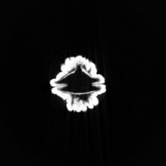
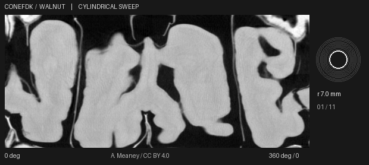

# ConeFDK · Windows 单 GPU 锥束 CT 重建

在一台 Windows 笔记本上，用 720 幅核桃 X 射线实测投影重建 **512³ 体数据**。原生 C++/CUDA 引擎完成锥束加权、cuFFT 分批滤波和按显存预算分块的反投影。Python 用来准备输入和独立校验；重建程序本身不需要 Python。

[English](README.md) · [个人主页项目详解](https://etherealbian.github.io/work/cone-fdk.html) · [Windows 稳定版 v0.1.0](https://github.com/EtherealBian/cone-fdk/releases/tag/v0.1.0) · [下载离线切片浏览器](https://github.com/EtherealBian/cone-fdk/releases/download/v0.1.0/walnut-512-viewer.html)



动图中的壳、隔膜和核仁均来自实测数据：[Alexander Meaney / 赫尔辛基大学](https://doi.org/10.5281/zenodo.6986012)，CC BY 4.0。离线浏览器可拖动查看 81 张预览切片，无需 CUDA。[数据署名与处理说明](NOTICE.md)

## 重建实测

| 问题 | RTX 5060 Laptop 上的结果 | 可复核记录 |
|---|---|---|
| 与独立实现相差多少？ | 720 角、512³ 输出，与 ASTRA FDK 的全体积相对 L2 差异 **0.02899%**，未拟合强度或配准。 | [数值对照](reports/RESULTS.md) |
| 优化实际省了多少时间？ | 与上一版原生引擎同机对比，整进程中位数 **2.392 → 2.009 秒**，六组配对输出逐字节相同。 | [逐次计时](reports/native-ab.json) |
| 超过显存还能重建吗？ | 以 **512 MiB 引擎设备缓冲预算**写出 1296³ FP32 体数据，落盘 8.71 GB；此规模用 ASTRA 抽查五层。 | [压力测试](reports/oversize.json) |

## 不生成整件，直接重建选区

用当前源码构建后，`--roi x,y,z,nx,ny,nz` 可以直接从投影重建一个长方体，例如只复查核桃壳与隔膜的交界。选区沿用原扫描的坐标和体素间距，可以与整件叠加。同一批 720 角投影实测：在 512³ 网格中重建 128 × 128 × 96 的选区，整进程中位数 **0.317 秒**，完整重建为 **1.561 秒**；六轮选区均与完整体裁剪逐字节一致。输出从 512 MiB 减至 **6 MiB**。旧版 v0.1.0 可执行文件不含此选项。

[选区位置、2048³ 网格上的独立校验、复现命令](reports/ROI.md) · [逐次耗时及文件哈希](reports/roi-walnut.json)

同一试件有多个位置要复核时，`--roi-list` 可以共用滤波后的投影。六个位置逐个重建耗时 **1.805 秒**，一次批量重建为 **0.351 秒**（六组整批中位数），投影只读一遍。每个选区与单独重建、完整体同位置裁剪逐字节一致；收紧预算后会自动分遍。[查看六个位置、显存代价和复现命令](reports/MULTI-ROI.md)。

预算紧时，可在 `--roi-list` 后加 `--planner min-passes`。同样六个位置、**48 MiB** 缓冲预算，每批从 16 个角度减至 8 个，整套投影从 **读三遍降到一遍**，整进程中位耗时 **0.590 → 0.304 秒**；六组输出均与原参考逐字节一致。默认策略不变。[不同预算的结果和复现步骤](reports/ROI-PLANNER.md)。

## 沿指定方向看截面

如果想沿着倾斜的结构往里看，用 `--plane` 指定切面中心、行列方向和像素间距即可。引擎从原始投影直接计算这一层，不需要先重建 512 MiB 的整件。核桃的一张 **320 × 288** 斜切面只输出 **360 KiB**；三个标准切面与完整体对应层逐字节一致。斜切面上分布取样的 365 点，与独立 CPU 双精度计算的相对 L2 差异为 **0.000164%**。另用已知尺寸的解析球体验证了三个截面的圆心和直径。[四张实测切片、误差口径与复现命令](reports/DIRECT-PLANES.md)。此功能需从当前源码构建。

要沿着结构连续往里看，可以用 `--stack` 重建一叠平行的斜切片，导出为带毫米坐标和方向的单个 NRRD 文件。在同一份核桃数据上，**21 层**斜切片与逐张运行的结果逐字节相同，整套投影从**读 21 遍减到 1 遍**。另用已知直径的模拟球检验了三维体积和球心。[查看斜向扫查动图、复现命令和误差](reports/OBLIQUE-STACK.md)。

## 把圆周摊开看

平面切片只能看到环形结构的局部。`--cylinder` 可以沿指定轴把完整一圈铺成图，核桃的 720 个实测投影只读一遍就得到半径 7–17 mm 的 11 张展开图。[下载离线圆柱展开台](reports/walnut-cylinder-atlas.html)：拖动半径看内外层，移动接缝追踪结构，或点击两点量同一圆柱上的最短表面距离。核桃不是规则圆柱，图层也不等同于核桃壳边界。[截图、误差和复现命令](reports/CYLINDER-ATLAS.md)。



## 找出管件哪一侧最薄

`cone-fdk wall` 沿每个高度和方位的半径找出内外界面，以毫米记录两者之间的距离。两件已知尺寸的模拟偏心管，最薄的 15° 扇区分别落在设计的 **358° 和 134°**，逐点壁厚最大误差分别为 **0.01322 mm、0.01065 mm**。给第一件加上与外管隔开的内衬后，6,120 条径向剖面全部识别为多层并拒测，不会把空气间隙算进壁厚。[看误差曲线、复核一条剖面或运行自己的扫描](reports/RADIAL-WALL.md)。这是当前源码的模拟验收，尚未用带尺寸真值的实物管件校准。

## 换个装夹位置，内外径还测得一样吗？

`cone-fdk bore` 在每个高度分别拟合内外圆，给出内外径、两个圆心的扫描坐标、偏心量和圆模型最小壁厚。对同一根管做模拟平移、旋转并重新生成投影后，原采样的外径最多变化 **0.01696 mm**；探测器间距和径向重建步长均减半时，变化降到 **0.00788 mm**，通过预设的 **0.012 mm** 门槛。单独加密重建不能让原扫描通过这项目标。[四组对照、椭圆拒测和复现命令](reports/BORE-GAUGE.md)。这是模拟结果，不是实物公差。

## 管件装斜了，能不能继续测内外径？

先用 `axis` 从外壁找出管轴，再从**同一份原始投影**重建垂直于它的截面。在 8° 和 12° 的模拟装夹中，原先每份扫描的 25 层都因斜切而拒测；找正后，25 层全部通过同一圆度门槛。计入一组带计数噪声的扫描，四组圆管的最大直径误差为 **0.0010905 mm**。外壁椭圆时不发布轴，只有内孔椭圆时仍拒报孔径。这些是对模拟设计真值的误差，不代表实物精度；找正管轴也不能确定两个缺陷是否在同一材料位置。[看找正前后曲线、六组正反例和复现命令](reports/AXIS-GAUGE.md) · [下载 CPU 复核包](reports/axis-review.zip)。

## 定位局部减薄，而不只报告最薄点

把已对齐的基准管和待测管交给 `cone-fdk loss`，会得到每处减薄的范围、面积、剩余径向壁厚，以及峰值处内外壁各变化了多少。在同一根模拟管上，外壁削平和内孔局部扩大的设计深度是 0.850、0.750 mm，测得 **0.857、0.756 mm**。削平区虽然出现在展开图的两端，仍只算一处。对完好管独立加入两份计数噪声，同一 0.30 mm 门槛下未报出区域。[检测图、带噪对照、适用边界与运行方法](reports/WALL-LOSS.md) · [下载可用 CPU 逐点复核的样包](reports/wall-loss-demo.zip)。

## 换了装夹，能不能量出同一处缺陷加深了多少？

同一根模拟管件换个角度再扫，按扫描仪网格硬比会报出 325 个超限单元。用四颗随件球标恢复材料坐标，再从原投影重建，原样复扫的 14,760 个单元里 **0 个超限**。把原有外壁平面再加工深 0.550 mm，同一法向的壁厚实测减少 **0.54796 mm**；少一颗标记则拒绝比较。[看固定网格与材料网格的对照、误差门槛及运行方法](reports/REMOUNT-LOSS.md) · [下载壁图逐点复核](reports/remount-deepened.zip)。这些数字来自模拟复扫，不是实物精度标定。

**如果四颗球一起滑了呢？** 模拟管件没有减薄，只把工装轴向滑动 0.80 mm，四球拟合残差仍只有 0.00681 mm，原流程却报出 159 个超限单元。现在可以用 `--witness` 启用管件本体上的三个独立见证点：两次扫描分别核对，任一点不通过就不生成壁图。它复用同一份 CUDA 侦察体，不额外读取投影，也不用这三个点修正位姿。[看滑移、绕点旋转和门槛附近的模拟结果](reports/BODY-WITNESS.md) · [下载三个小窗，在 CPU 上复核](reports/witness-pivot.zip)。

**换个边缘阈值，还会报减薄吗？** 带噪模拟复扫在标称设置下有 263 个单元超出 0.30 mm。让两次扫描各自选择三档边缘阈值，**253 个单元在九种组合下始终超限，22 个随设置翻转**；只试同档配对只能看到其中 1 个。直接从已配准的壳层追加 4 次 CUDA 壁厚测量，不再读投影。[看材料网格、九格读数和复现步骤](reports/EDGE-REVIEW.md) · [下载整张图，无需 GPU 逐点复核](reports/edge-review-example.zip)。这是离散设置的敏感性检查，不是实物精度或置信区间。

**整片内凹是否仍然连通？** 同一件带噪声模拟管的九组全局阈值都得到一片连通区域；在 9.4 mm 参考半径上，投影面积为 **8.301–9.023 mm²**，标称值 8.630 mm²。可以[离线复算每组面积、峰值和区域拆合](reports/REGION-REVIEW.md)，或把多件放进[支持中断续算的批检](reports/REGION-BATCH.md)，分别保留完整覆盖、不可测与拒测。

从已有壳层提取多档壁厚时，[CUDA 多档提取器](reports/WALL-PACK.md)每块只上传一次。八档中位数由 **1,219 ms 降至 180 ms**，六组配对的逐档记录完全相同；计时仅覆盖壁厚工序。

## 扩展实验：在金属 CT 中逐孔测量

[孔隙测量分支](https://github.com/EtherealBian/cone-fdk/tree/measurement-lab/pores)的输入是已重建的钴铬合金 CT。给定掩膜，CUDA 程序能逐孔计算体积、等效直径和质心。从灰度中自动找准孔边界则仍有误差：候选 E 在 2、3、5 号开发试件分别通过 **10/11、6/11、7/11** 项，最差试件的匹配孔体积误差 P95 为 **28.16%**，门槛为 **15%**。4、6 号保留件未启用；该实验不包含在稳定发布包内。

[三件结果与原始档重放](https://github.com/EtherealBian/cone-fdk/blob/7b9d4bfc9c1ea8fe2750baa1a2b8154bfd09b418/pores/RETAINED-BASELINE.md) · [看同一切片上两个孔如何被连成一个](https://etherealbian.github.io/work/cone-fdk.html#pore-pair) · [四件外部试件的不同数字边界](https://github.com/EtherealBian/cone-fdk/blob/7b9d4bfc9c1ea8fe2750baa1a2b8154bfd09b418/pores/EXTERNAL-REFERENCE-AGREEMENT.md)

## 从源码运行

```powershell
git clone https://github.com/EtherealBian/cone-fdk.git
cd cone-fdk
# 按下节安装锁定依赖；在 x64 编译器环境中先从源码构建
.\Build.ps1
.\Demo.ps1                 # 离线：90 个实测角，原生 / ASTRA 对照，输出阅片器和 MetaImage
.\Run-Acceptance.ps1       # 重编译 + 回归 + 精度 + 性能 + 超显存 + 全部 720 个实测角
```

演示输出 `reports/walnut-viewer.html` 可直接在浏览器打开，无网络服务；`data/walnut-corrected-256.mhd` 和同目录 `.f32` 是保留定量信息的完整体。全量测试另外生成 `data/full-corrected-512.mhd`、对应 `.f32` 和 `reports/full/walnut-viewer.html`。HTML 内置 81 张固定显示窗的轴向预览，不是全部切面，也不应用来量灰度。

## 从发布包到新环境

Windows x64、支持 compute_80 PTX 和 CUDA 12.9 PTX JIT 的 NVIDIA GPU/驱动。发布包附已编译的 EXE/PTX，**不附第三方 DLL、Python、自称可用的模拟 GPU 或扫描仪**。使用 Python 3.12 x64，并允许从 Python 包源安装锁定的依赖。若需重编译，准备 x64 MSVC Developer PowerShell 或 MinGW-w64；本次测试使用 MinGW。本机还验证了两次从源重编所得 EXE/PTX 的 SHA-256 一致，见 [构建记录](reports/build-repro.json)；不同编译器或驱动未作这种承诺。验证已解压文件：`Get-FileHash` 可对照随包的 `SHA256SUMS`，或运行 `py -3.12 scripts/release.py verify .`。

```powershell
py -3.12 -m venv .venv
.\.venv\Scripts\python.exe -m pip install -r requirements-win.lock
.\Demo.ps1
.\Run-Acceptance.ps1 -SkipBuild            # 验证交付的二进制
.\Run-Acceptance.ps1 -CoreOnly -SkipBuild  # 较短；跳过超显存与全角测试
```

默认完整验收需要按 Zenodo 记录下载约 4.24 GB 原始归档，已有归档会核验 MD5 并复用；建议预留 **25 GiB** 可用磁盘。`1296³` 压力测试的临时原始体核验后删除。该固定尺寸用例特意断言输出大于本机物理显存，换到显存更大的 GPU 不能原样证明“超显存”，应调整压力体和取样几何。WDDM 遥测基于本地 Windows 显示驱动栈，其他系统、卡型与工具链不在这次验收范围。

如需自行打包：完成全量验收，并按 [A/B 复现步骤](reports/OPTIMIZATION.md) 生成本次二进制的性能与跨版本输出记录；用 `.\Build.ps1 -VerifyRepeat` 自动双编并记录二进制指纹（只有指纹一致才通过）。运行 `python scripts/release.py build`，再用同一验收环境运行 `python scripts/check_release.py dist/ConeFDK-win-x64.zip`。后者在临时中文路径内校验全部成员，删掉已有演示图，重新从随包投影生成体数据并逐张校验 81 张 PNG。结果写到包旁的 `verification.json`。

## 自有扫描如何接入

`scan.geom` 是单行 ASCII，依次为标记、视角数、探测器行/列数、U/V 像素间距、源到等中心距离、源到探测器距离、起始角（弧度）、旋转符号（±1）。例：

```text
CFDK1 720 296 280 0.4 0.4 210.66 553.74 0 1
```

`scan.f32` 是小端 float32 的**线积分**（不是未校正强度），连续布局 `[角度,v,u]`，索引 `u` 最快。只接受完整均匀圆轨迹，第 `i` 角为 `start + sign * 2πi/views`；不要把 360° 终点重复输入。输出 `[z,y,x]`，每轴 `n`，体素中心位置 `(index-(n-1)/2)*fov/n`。距离与 FOV 用 mm，输出衰减用 mm⁻¹。包装器仅把 wheel 的 CUDA DLL 路径加入子进程环境；独立运行 EXE 时让 CUDA 12 的 cuFFT 及其依赖可被 Windows 加载器找到。

```powershell
# 在已运行 Demo 的目录；不加 --astra 默认执行自研 EXE
.\.venv\Scripts\python.exe scripts/reconstruct.py data/walnut-corrected data/my-volume.f32 --n 384 --fov 40 --budget 512 --batch 16
# 已配置 NVIDIA DLL 路径的独立终端，同一工作不需要 Python
.\build\cone-fdk.exe --ptx build/kernels.ptx --geom data/walnut-corrected.geom --input data/walnut-corrected.f32 --output data/my-volume.f32 --n 384 --fov 40 --budget 512 --batch 16
```

CLI 成功时 stdout 输出 JSON；失败返回非零并将错误写入 stderr。校验长度、几何、有限性和路径别名；同目录临时文件完整写入并 flush、显存边界校验后才替换目的文件。显存预算单位 MiB，不等于整个进程或驱动的峰值。`--host-memory auto`（默认）分别尝试锁页输入和输出暂存区，每块上限 8 MiB；超过上限或锁页内存不足时使用普通主机内存。`--host-memory pageable` 禁用锁页。`host_pinned_bytes` 单列实际锁页主机字节，不计入设备缓冲峰值。

## 哪些部分值得读

| 路径 | 解决的问题 |
|---|---|
| `src/kernels.cu` | 先乘 `DSD/sqrt(DSD²+u²+v²)`；U 方向零填充到至少两倍探测器宽度，按离散 Ram-Lak 滤波。以体素为中心双线性采样；探测器外零延拓。每线程算 16 个相邻 Z，保留原四层组的坐标舍入顺序。用已释放使用权的 FFT 缓冲暂存水平插值系数；两侧零哨兵维持零延拓。 |
| `src/main.cpp`、`src/gpu.hpp` | 按预算规划角度批与 Z 分块，显式管理 cuFFT 工作区。分块复用缓冲，保持视角累加次序，每个 slab 付出重读重滤的代价；含 CUDA Event 计时、边界哨兵与占用计数。 |
| `src/files.hpp` | Windows Unicode 文件、身份别名检测、大体积分段写出及事务式发布。 |
| `tests/test_spatial_oracle.py` | 小体积独立 FP64 空间域参考：直接卷积而非 FFT，用射线与平面的交点逐体素核验 GPU 实现。 |
| `scripts/phantom.py`、`scripts/accept.py` | 用解析射线与有限圆柱/球相交生成独立真值；核验孔位、孔径、衰减、离面夹杂及全体积误差。 |
| `scripts/full_walnut.py`、`scripts/prepare_walnut.py` | 按原始元数据构造真实几何。原始投影已校正暗场/平场；每帧原图左上 128×128 算空气基准，水平循环左移 5 原始像素，8×8 强度均值后取负对数。另保留未移位的对照。 |
| `scripts/benchmark.py`、`scripts/stress.py` | 新进程交替测本机 GPU 与 ASTRA；压力测试真正落盘超显存体并跨接缝用 ASTRA 独立核查五层。 |

## 适用边界

这是面向工业 CT 算法与 GPU 工程的可复现原型，**不是经过计量检定的工业检测设备或医疗软件**。仅支持居中、平板、等角间隔的单圈锥束。默认整件输出为各向同性立方体；定向切片和层栈可分别指定各轴间距。圆轨迹 FDK 在离中平面处是近似；没有螺旋、短扫描/Parker、散射与硬化校正、金属伪影消除或实际缺陷检出认证。512³ 网格间距不等于系统真实空间分辨率；与 ASTRA 一致也不代表实物尺寸真值。许可证、数据署名及变换说明见 [NOTICE](NOTICE.md)。
