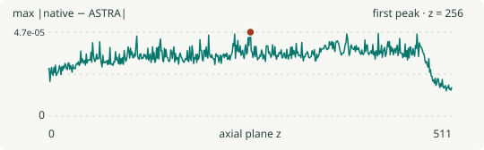

# Run the Spark walnut example

## Inspect two real regions without CUDA

From the repository root, run this with Python 3.12. It reads the paired FP32 subvolumes directly from the checkout. No downloads, NumPy, ASTRA, GPU or device access are needed.

```sh
D=examples/gb10-walnut
python3 -I -S -B platform/spark/review_grid_oracle.py "$D/qualification.json" \
  445b3a5ad5a6585b9621a7d57ca6fb1661e403b27714613e997907449cf730ac \
  "$D/native.mg" "$D/astra.mg"
python3 -I -S -B "$D/test_review.py"
```

| Parent grid | Region (X × Y × Z) | Voxels checked | Relative L2 | Maximum absolute difference |
|---|---|---:|---:|---:|
| 225³ | 39 × 53 × 31 | 64,077 | 0.000230125 | 0.0000539310 |
| 384³ | 47 × 59 × 27 | 74,871 | 0.000338438 | 0.0000453368 |

These are two regions of the **same 720-view walnut acquisition**. The verifier checks grid headers, pins, layout, per-plane statistics and the global error gates. The four public tests include a changed voxel, swapped arrays and an incorrect receipt hash. This checks the committed data; it does not rerun ASTRA. See the [request](../../examples/gb10-walnut/request.json) and [data attribution](../../NOTICE.md).

## Run native CUDA from a fresh source checkout

Tested on Linux ARM64, NVIDIA GB10, CUDA 13.0.88 and g++ 13.3. Use a fresh checkout with no `build/` directory. The native executable loads the CUDA driver and cuFFT (`libcufft.so.12`); ASTRA is not linked. NumPy is needed only to unpack the included 90-view fixture for this example. The multi-grid qualification builder intentionally refuses a base product that differs from its pinned compiler/toolkit output. Such a refusal is not a numerical result.

```sh
python3 -B platform/spark/build.py
python3 -B platform/spark/build_multigrid.py build/multigrid
python3 -B examples/gb10-walnut/native_demo.py
```

The native demo reads the 90-view subset shipped with the repository. It reconstructs two grids with a single projection pass, then separately reconstructs each ROI and compares its full byte hash. The successful output includes `matched_standalone: 2`. This smaller example is **not** the 720-view timing benchmark or an independent solver check.

## What the release establishes

- [Full walnut comparison](../../reports/gb10/walnut-astra.json): 134,217,728 voxels; no registration or fitted intensity scale. [Two native repeats](../../reports/gb10/walnut-native.json) produced identical bytes.
- [Three-grid timing](../../reports/gb10/multigrid-timing.json): 192³ overview, 512-grid ROI and 1024-grid detail. Six warm pairs, 3 → 1 projection reads and 135 → 45 filter batches. Median native process time includes startup and output sync, excludes sealing, verification and export.
- [Independent ASTRA grid audit](../../reports/gb10/grid-agreement.json): 12,618,525 voxels on the three preset grids. [Host-buffer comparison](../../reports/gb10/astra-buffer-timing.json): six interleaved pairs, unchanged output, median pipeline 650.894 → 545.263 ms. These are not device-memory savings or native FDK timings.
- [Spark workspace regression](../../reports/gb10/spark-regression.json): 853 passed in the qualified workspace. Some tests and production qualification drivers require external acquisitions, retained caches and pinned prior jobs; this is not a claim that the whole suite runs on a standalone clone. The [periodic-only overlay](../../reports/gb10/historical-regression.json) passed 648 of 707 historical tests; the [slab compatibility overlay](../../reports/gb10/slab-compat-regression.json) passed 667, and the [directory edge overlay](../../reports/gb10/directory-edge-regression.json) passed 697 of the same 707, with no new failures.
- [Physical batch](../../reports/gb10/physical-coverage.json): one of two planned specimens in this snapshot. A solver comparison does not establish a physical measurement tolerance. Raw scans, scratch products and private execution logs are not part of this release.

## Resume a five-slab job without changing a legacy callback

On the qualified DGX Spark, a 720-view walnut reconstruction was interrupted with `SIGKILL` after two durable slab commits. No final delivery existed. A synchronous callback using the original path-based CUDA command resumed the remaining three slabs. All 536,870,912 output bytes matched the retained dense volume; the original verifier reopened the delivery with only the Python standard library. See the [measured recovery receipt](../../reports/gb10/slab-recovery.json).

To check the compatibility layer without an acquisition or GPU job, start at the checkout root on ARM64 Linux with Python 3.12 and pytest:

```sh
python3 -B -m pytest -q -p no:cacheprovider platform/spark/tests/test_slab_compat.py
```

For an integration, build the module in a fresh directory, separate from the periodic overlay. Import it before the historical `scripts/` directory:

```sh
D=$(mktemp -d)
python3 -B platform/spark/build_slab_compat.py "$D/overlay" \
  --expect f53f88ed79fe450ea502387d6152665ecd453c09a0efbbb76f7940e30dd7769a
PYTHONPATH="$D/overlay:$PWD/scripts" python3 -B -c 'import slab_replay as s; print(s.__file__)'
```

Native jobs require the exact plan, acquisition, ELF and PTX pins. The default worker inherits sealed file descriptors. A custom callback gets temporary paths to the same sealed bytes and can run a synchronous child; it must not save these names for later. The original names may be renamed or modified on Linux. A new invocation rejects a changed source even with a completed checkpoint. This checks process recovery on trusted local storage, not recovery after power loss. The [historical comparison](../../reports/gb10/slab-compat-regression.json) lists every remaining failure, including four tests that require Windows-style denial of original-path writes.

<a id="offline-threshold-review"></a>
## Recount wall-loss footprints from the published masks (no GPU)

These **simulated** reference/inspection pairs use a 41 × 360 cylindrical grid. At each threshold pair the same two edge levels apply across the entire grid. The wall-loss gate stays at 0.3 mm. The repeat and noisy-change cases use 3 × 3 pairs; the invalid-edge control was archived with 2 × 2. Do not replace its missing observations with zero loss.

```sh
D=reports/gb10
python3 -I -S -B platform/spark/review_directory_masks.py \
  "$D/directory-edge-qualification.json" \
  39b156760dc467967d9372701843b392fd07c9347d35b5509d17d8da0723aa31 \
  "$D/directory-edge-masks.zlib"
```

Expected: **9 + 9 + 4 label grids, 324,720 cell decisions**. The 590-byte compressed input holds classified cells, not raw projections or precomputed component labels. A standard-library flood fill wraps across the angular seam but not the axial ends, assigns each region its first row-major cell ID, and checks the entire little-endian label grid against the pinned receipt. It also checks the unknown-cell, flagged-cell and region counts. It does not re-estimate wall thickness. [Raw CPU-to-CUDA checks and frozen file comparisons](../../reports/gb10/directory-edge-qualification.json) come from a separate Spark run with the original archived materials.

### Reopen a witnessed directory on the qualified Spark

After the default native `build.py` above (which creates the historical `.exe` names as symlinks to local ARM64 ELF products), use Python 3.12 with NumPy and SciPy. Build an optional module overlay in its own fresh directory. The destination's real parent directory must already exist.

```sh
D=$(mktemp -d)
python3 -B platform/spark/build_edge_compat.py "$D/overlay" \
  --expect 8ce35c3262a7d95de292616a5daa58655c41e60cd72710501a8ead7a78adeeb7
PYTHONPATH="$D/overlay:$PWD/scripts" python3 -B -m edge_review_packed --help
```

With your original witnessed job, its externally obtained manifest hash, and the original producer directory available, run:

```sh
PYTHONPATH="$D/overlay:$PWD/scripts" python3 -B -m edge_review_packed \
  "$PARENT_JOB" "$D/new-review" --levels 0.018 0.020 0.022 --budget 1 \
  --parent-sha256 "$PARENT_SHA256" --source-products "$ORIGINAL_PRODUCTS" \
  --companion-sha256 6351b4db3aa52e1df6a9651ccc329dcb238c45c6cdbc498dbd0c6cef9a72e7dc
```

Original producer files are authenticated as data and are not executed. Only the locally pinned ELF/PTX products run; `--source-products` can be omitted for a matching local producer. For a published result, exit 0 means complete coverage and 2 means the result contains unknown cells. Rejected inputs produce no delivery. This interface is for trusted local filesystems and synchronous consumers, not a distributed lock or power-loss guarantee. The full three-case CUDA qualification needs the archived source objects; only the offline mask check is self-contained. [Matched historical regression](../../reports/gb10/directory-edge-regression.json): 697 of the same 707 tests passed; the ten remaining failures are listed by name.

## Offline physical peak

Where do native FDK and ASTRA differ most on the measured walnut? This snapshot of the physical queue lets you check the answer without either solver. Use Python 3.10+ from the repository root, with `platform/spark/residual_witness.py` next to the reviewer. No installation, network, NumPy or GPU is required.

```sh
python3 -I -S -B platform/spark/review_physical_snapshot.py examples/physical-peak-walnut 98311760b93bf8636479d87b2b429a881b667ba649f987d2047c19dfada60370
```



The reader reaggregates **512 reported plane rows**. It then reads **262,144 raw float32 pairs** from the plane with the highest peak. The first maximum in z, y, x traversal is at zero-based **(x=367, y=318, z=256)**: absolute intensity difference **0.000047359615564346313**. The chart uses every row, unsmoothed, with a linear intensity axis. To regenerate it, run `plot_physical_profile.py` with the same folder and pin, then `walnut720` and a **new** SVG filename. No raw voxels from the other 511 planes are in the pack. This measures agreement between implementations, not error against a calibrated specimen.

**Trust and coverage.** Obtain the catalog pin above from a trusted release, not from the submitted files. It binds the pack, case commit hashes and (if supplied) the external pine parent. The reader checks the frozen plan and parent receipts, case → committed report → plane hashes, volume lineage and reported totals before remeasuring the two slices. It does not refetch a scan, rerun either solver, or query the live queue. At this snapshot the walnut accounts for **1 of 2 specimens and 1 of 3 scan conditions**. Omitted cases have no metrics. `--require-complete` exits 3 without emitting a result; malformed or misbound data exit 1. A later submission does not change this snapshot.

**Export on the qualified Spark.** Pass the private queue and a fresh output directory to `platform/spark/pack_physical_snapshot.py`, with `--commit CASE COMMIT_SHA256` once for **every committed case**. Supply `--pine-parent SHA256` for committed pine cases. The producer invokes the original queue checks, authenticates the exact commit set under its lock, and rereads the detached result before publishing without replacement. Report hashes (including a correctly computed orphan) are not commit hashes. The fixed-order binary uses a magic header and bounded little-endian length-prefixed members, no executable code, extracted filenames or compression. [Measured export, refusals and comparison with the original walnut run](../../reports/gb10/physical-peak-snapshot.json) · [Acquisition and CC BY 4.0 attribution](../../NOTICE.md).
