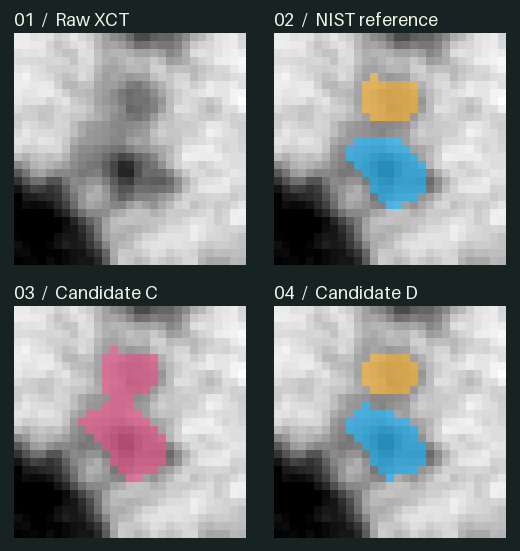

# 三维孔颈实验：拆开了两个孔，逐件验收仍未通过

候选 D 将相邻切片的证据加入 CUDA 滤波后的孔隙边界估计。[方法和案例](EXPERIMENT-D.md)在评分前登记。以下均为开发试件，输入是已重建的 NIST 钴铬 XCT；每件用自己的独立标注切片做校准。[原定 11 项门槛](FINAL-GATE.md)与孔匹配规则不变。

| 试件 | 方法 | Dice | 孔隙率偏差（百分点） | 匹配 / 合格预测 / 合格参考 | 匹配孔体积绝对相对误差：中位 / P95 | 通过项 |
|---|---|---:|---:|---:|---:|---:|
| [2](evidence/candidate-c/sample2.json) | C | 0.95151 | +0.00023 | 71 / 73 / 73 | 2.94% / 22.05% | 10/11 |
| [2](evidence/candidate-d/sample2.json) | D | 0.94767 | +0.01038 | 66 / 68 / 73 | 4.08% / 20.68% | 9/11 |
| [3](evidence/candidate-c/sample3.json) | C | 0.97302 | +0.00299 | 24 / 28 / 27 | 9.25% / 38.14% | 6/11 |
| [3](evidence/candidate-d/sample3.json) | D | 0.97665 | +0.01354 | 25 / 29 / 27 | 6.08% / 33.16% | 7/11 |
| [5](evidence/candidate-c/sample5.json) | C | 0.98105 | -0.04586 | 11 / 13 / 12 | 4.14% / 24.32% | 9/11 |
| [5](evidence/candidate-d/sample5.json) | D | 0.98345 | -0.00625 | 10 / 15 / 12 | 7.65% / 18.73% | 6/11 |

P95 上限为 15%；三件都未达到。每件的孔隙率绝对和相对误差都达到目标。试件 5 的 D 虽有较高 Dice，15 个合格预测只匹配到 10 个，不能把整体体素重合当成逐孔可靠。未匹配对象不参与体积百分位，单列在覆盖率中。

### 只看 C 和 D 都匹配到的同一批参考孔

| 试件 | 共同匹配 | D 新匹配 / 丢失 | 共同孔 P95（C → D） | 绝对体积误差变小 / 不变 / 变大 |
|---|---:|---:|---:|---:|
| 2 | 66 | 0 / 5 | 19.74% → 20.68% | 25 / 2 / 39 |
| 3 | 24 | 1 / 0 | 38.14% → 33.55% | 16 / 0 / 8 |
| 5 | 10 | 0 / 1 | 24.45% → 18.73% | 4 / 0 / 6 |

这张配对表用于区分边界改善和匹配对象变化；不替代前表的全量验收。

## 回到试件 3 的原始切片

`set1sample3raw_0455.tif`，X=[378,407)，Y=[600,629)，零基坐标。四格取自相同的 29×29 像素区。蓝：参考 121 或对应的 D 孔；黄：127 或对应的 D 孔；粉：C 的同一连通体。体积数来自完整三维对象，而不是数图上的像素。原始数据：Kim 等，NIST，[10.18434/M32162](https://doi.org/10.18434/M32162)。

- C 的预测 3405094 有 436 个体素，一对一规则只能匹配 121（参考 296 个体素，高估 47.30%）；对 127 没有独立匹配。
- D 分别预测 278 和 108 个体素；对照 296 和 128 个体素，误差为 −6.08% 和 −15.63%（后者精确值 −15.625%）。另两个参考孔 177、199 仍与同一裁边预测相交，不能算独立匹配。详见 [C](evidence/candidate-c/sample3-overlap.csv) 与 [D](evidence/candidate-d/sample3-overlap.csv) 的完整体素交集表。

## 对照：只切一颗体素能修复吗？

[预先规定的单体素切断操作](ARTICULATION.md)只读取 C 预测掩膜，不访问参考来选择切点；对每个不碰裁边的原对象至多切一次，切后两侧都必须至少 64 个体素。它仅用来验证机制，不能冻结为正式预测器。

| 试件 | 切点 | 发生变化的参考匹配 | 匹配孔体积误差 P95 |
|---|---:|---:|---:|
| [2](evidence/articulation-c/sample2.json) | 1 | 1 | 22.07% |
| [3](evidence/articulation-c/sample3.json) | 0 | 0 | 38.14% |
| [5](evidence/articulation-c/sample5.json) | 0 | 0 | 24.32% |

试件 3 的并孔无法靠这一规则拆开；试件 2 唯一的切点反而使参考 44 失去匹配。不将这项后处理纳入发布管线。

## 复核入口

- [D 的三个离线 ZIP 与 SHA-256](https://github.com/EtherealBian/cone-fdk/releases/tag/measurement-evidence-2)：解压后先开 `*-cases.html` 按误差找孔，再开 `*-review.html` 核对整幅切片。原始灰度查看器是固定窗宽显示，掩膜无损。
- [D 的 JSON / CSV](evidence/candidate-d)：`*-overlap.csv` 枚举任一端合格的所有非零交集，另记完全无交集的合格对象（对端 ID 0）；两列辅助计数为交集达到对端至少 1/4 且对端 ≥64 体素的对象数，含裁边对象。它不是正式的一对一匹配。`*-size-bands.csv` 按参考孔体素数分段列出误差。
- 复现 D 的预测实现见 `65db5e5`。`python pores/audit.py build/candidate-D --development 2 3 5 --cache <archive-directory>` 从源档、复核掩膜与组件表重算；三件均重放一致，因数值不达标返回 1。`freeze.py` 拒绝生成确认清单。试件 4、6 未评分。
- [基线与 A/B/C](RESULTS.md) · [稳定的核桃重建器 v0.1.0](https://github.com/EtherealBian/cone-fdk/releases/tag/v0.1.0)。这里检验与数字分割的一致性，不是物理尺寸认证。
