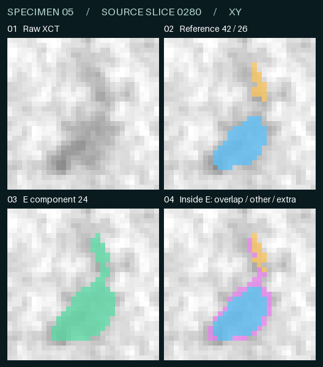

# 跨试件校准：别的试件能教会模型把这个孔量准吗？

对每个开发试件取一段新的 96 层区域，用另外两个试件的完整孔学习边界该向内还是向外移动。候选 E 本身仍只用本件原来的 24 层训练。先公开[实验规则](TRANSFER-PILOT.md)和[三个概率体哈希](evidence/transfer-pilot/baseline.json)，再读取新区域标注（登记 `45ee74d`，预测存证 `7d11017`）。本页的 z=[256,352) 与原开发评分区域 z=[400,528) 不同；不能把两次结果当作同一批孔比较。

| 目标试件 | 另一试件提供的拟合对数 | 共同小孔数 | 共同小孔体积误差 P95：修正前 → 后 | 全部匹配孔 P95：前 → 后 | 漏检：前 → 后 | 未匹配预测：前 → 后 | 筛选 |
|---|---|---:|---|---|---:|---:|---|
| [2](evidence/transfer-pilot/sample2.json) | 3 号：16，5 号：8 | 8 | 17.70% → 20.77% | 10.77% → 14.74% | 2 → 2 | 1 → 1 | 未通过 |
| [3](evidence/transfer-pilot/sample3.json) | 2 号：23，5 号：8 | 5 | 22.37% → 19.65% | 27.58% → 24.17% | 4 → 4 | 1 → 1 | 未通过 |
| [5](evidence/transfer-pilot/sample5.json) | 2 号：23，3 号：16 | 2 | 19.42% → 20.37% | 28.56% → 28.96% | 3 → 3 | 0 → 0 | 样本不足 |

**不采用这项修正。** 事先规定三个目标试件都要通过；不能只选改善的试件，也不能把每个试件的孔合并计算一个 P95。

“共同小孔”是两个掩膜都匹配到的同一批 64–127 体素参考孔。每件至少需要 5 个共同小孔、每个供样试件至少 5 对；同孔 P95 须下降至少 3 个百分点，全部匹配孔 P95、漏检数、未匹配预测数均不能增加。正式 15% 门槛仍见[最终验收协议](FINAL-GATE.md)。

## 新切片里有多少完整孔？

| 试件 | 完整 32–63 / 64–127 / ≥128 体素 | 裁边 ≥64 | 可供其他件拟合的匹配对 | 基线 / 修正匹配数 | 共同小孔误差：变小 / 不变 / 变大 |
|---|---:|---:|---:|---:|---:|
| 2 | 5 / 8 / 41 | 20 | 23 | 47 / 47 | 0 / 2 / 6 |
| 3 | 5 / 7 / 17 | 36 | 16 | 20 / 20 | 3 / 0 / 2 |
| 5 | 5 / 3 / 9 | 20 | 8 | 9 / 9 | 0 / 1 / 1 |

每个供样对必须有完整预测和完整参考，预测为 32–256 体素、参考至少 32 体素，并符合一次性一对一 IoU 匹配。上表“可供拟合”与正式合格孔数不是同一个分母；没有把裁断的孔当完整体积。

## 即使知道每个孔该增减多少，边界能挪得够远吗？

事后诊断，不用于拟合或筛选：固定基线已匹配的孔和它们的 ID。给每个孔最有利的增减方向和数量，仍只允许实验规定的内外一层及 25% 边界上限；没资格调整的孔维持原体积。忽略连通体改变和新增/丢失匹配，所以这只是**直接修正体积的理想下界**，不是可部署模型的成绩，也不是其他分割方法的极限。

| 试件 | 基线匹配孔中误差 >15% | 理想调整后仍必然 >15% | 理想 P95（固定匹配） | 剩余误差最大的参考孔：参考 / 基线 / 可直接调整区间（体素） |
|---|---:|---:|---:|---|
| 2 | 1 | 0 | 6.90% | #106：354 / 321 / [321, 321] |
| 3 | 4 | 0 | 10.15% | #108：147 / 203 / [166, 240] |
| 5 | 2 | 1 | 24.43% | #42：1153 / 1548 / [1548, 1548] |

### 试件 5，第 280 层：一个预测连到了两个参考孔

参考孔 #42 有 1153 体素，E 的同一连通体却有 1548 体素。它覆盖本孔 1147 体素、另一个完整参考孔 #26 的 282 / 309 体素，以及 119 个参考背景体素，同时漏掉本孔 6 体素。净高估 282 + 119 − 6 = **395 体素（34.26%）**；#26 没有独立的一对一匹配。下一步应检验如何拆开被误连的孔，而不是继续给整个连通体统一增减体积。



[源坐标和交集计数](evidence/transfer-pilot/sample5-merge.json)。这张图选取一个二维四连通的预测区域确实同时覆盖两个参考 ID 的轴向切片；图上颜色只显示这一层，以上计数来自完整三维掩膜。

### 能否在没有参考标注时提醒人复核？

[探索性提醒规则](BRIDGE-REVIEW.md)：在 E 的 0.5 连通体内查找彼此不连通的 0.90 高置信核心；至少两个核心各有 ≥32 体素且各占母体 ≥5% 才提醒。查看参考掩膜时，将同一合格预测覆盖两个不同完整参考孔各至少一半定义为对照事件。规则是在已看到 5 号案例后设计的，不能据此估计泛化性能。

| 试件 | 合格预测连通体 | 提醒且符合事件 | 误报 | 漏掉的事件 | 未提醒且无此事件 |
|---|---:|---:|---:|---:|---:|
| 2 | 48 | 0 | 0 | 0 | 48 |
| 3 | 21 | 0 | 0 | 0 | 21 |
| 5 | 9 | 1 | 0 | 0 | 8 |

[全部预测孔、核心体积、覆盖参考 ID 与分母](evidence/transfer-pilot/bridge-review.json)。复核包下拉框会标出命中的母体；它只是提醒，**没有拆开误连，也没有改善任何计分**。对自己的概率图可运行 `python scripts/pore_bridge_review.py --probability <float32-ZYX.npy> --out queue.json`，不需要参考标签。

## 复核一个孔，或重放所有评分

1. 下载[三件合一的离线复核包](https://github.com/EtherealBian/cone-fdk/releases/tag/boundary-transfer-pilot-1)，核对附件 SHA-256 后解压。打开 `sample2-slices.html`（或 3、5 号），选择参考 ID 或未匹配预测。滑块遍历全部 96 层；原始灰度、NIST 数字标注、E 基线和修正后掩膜显示在同一坐标。橙色为新增、紫色为删除体素。
2. 压缩包里的 `*-review.npz` 保留未量化的 float32 概率，及无损的参考、基线、修正后三个掩膜。`*-pores.csv` 中的 `id` 是原生计量器的种子线性编号；JSON 中 `pred` 是 SciPy 扫描顺序标签，两者可用 CSV 的种子坐标关联，不能直接当作同一个编号。
3. 从对应版本的仓库根目录，安装计量实验的锁定依赖。运行 `python scripts/pore_transfer_replay.py <解压目录> --viewers`：无需 GPU 即可用概率体和另两件的供样重新拟合，逐体素重放最终掩膜、检查组件表、匹配和评分。加 `--cache <NIST档案目录>` 可同时从原始 TIFF 核对所有参考体素和显示灰度。
4. 从源档重做 GPU 实验：按测量分支说明编译 `pores/Build.ps1`；依次运行下列命令。所有目录参数使用实际路径，两个输出目录必须为空。

```powershell
python scripts/pore_transfer_predict.py --cache <cache> --out <baseline>
python scripts/pore_transfer.py --cache <cache> --baseline <baseline> --out <out>
Copy-Item <baseline>/baseline.json <out>/baseline.json
python scripts/pore_transfer_view.py <out> --cache <cache>
python scripts/pore_transfer_replay.py <out> --cache <cache> --viewers
```

CUDA 计算六面邻接壳层的唯一归属；勾连多个不同预测标签的背景体素不归任何一孔。用独立的 SciPy 腐蚀/膨胀逐体素核对内外边界，修正后重新做连通体分析。两个掩膜各用 8 层、37 层分块输出，同件同一掩膜的两张组件表必须字节一致。回归和评分在 CPU 上，未声称整套研究流程都是 CUDA。

研究结果只描述与 NIST 数字分割的一致性。4、6 号确认区域未用于本实验；稳定版仍为核桃重建 v0.1.0。
