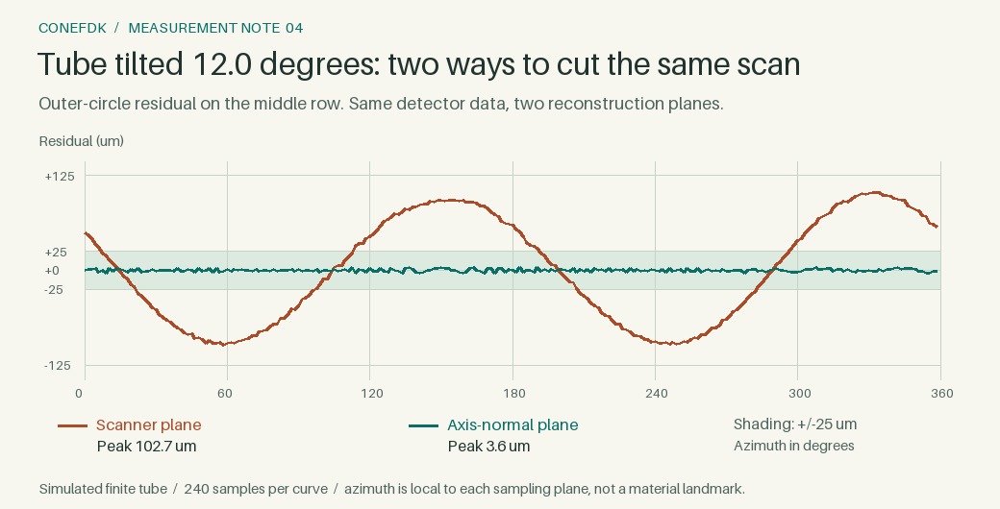

# 倾斜装夹的管件：先找轴，再用原始投影量内外径

一根圆管装斜后，在扫描器的水平面切出来是椭圆。沿用原来的圆形门槛很容易拒测；放宽门槛又会把真正的椭圆孔也量成圆孔。`cone-fdk axis` 先从一段外壁求出**一条扫描坐标系中的直线**。只有整段外壁符合直圆柱模型，才沿这条线回到原始投影，重新生成与轴垂直的截面。两次重建都直接做在圆柱网格上，不生成整件体数据，也不旋转已有展开图。



图中两条曲线来自同一份 12° 模拟扫描的两次重建，每条各有 240 个外界面点。分别拟合截面圆后，最大绝对残差由 **0.10275 mm 降到 0.0036 mm**。阴影是相同的 ±0.025 mm 接受区。这是截面圆的残差，不是对真实尺寸的误差，也不同于整段外圆柱的残差。

## 六份独立生成的投影

每份含 360 个角度，探测器 640 × 144，像素间距 0.07 × 0.14 mm。有限长 36 mm 实体按射线与内外界面及端盖求交，取三个水平子像素的平均；无体素化真值。重建段长 6 mm，25 个高度，半径步长 0.03 mm。一律从同一份粗网格起步，未将设计轴传给测量程序。材料界面阈值固定为 0.02；轴和截面圆的最大形状残差门槛都是 0.025 mm。

| 模拟工况 | 找正前 → 后：可测截面 | 轴方向误差 | 内、外径最大绝对误差 | 偏心量最大绝对误差 |
|---|---:|---:|---:|---:|
| 直立基准，ID 12.4 / OD 19.2 mm | 25 → 25 | <0.000001° | 0.000908 mm | 0.000077 mm |
| 同件，旋转、平移并倾斜 8° | 0 → 25 | 0.000660° | 0.000782 mm | 0.000506 mm |
| 另一尺寸，ID 11.8 / OD 17.4 mm，换方向倾斜 12° | 0 → 25 | 0.001737° | 0.0010905 mm | 0.000547 mm |
| 8° 同件，加固定种子泊松计数噪声 | 0 → 25 | 0.002667° | 0.000762 mm | 0.000709 mm |
| 外壁椭圆，半轴 9.6 / 9.2 mm | 0 → 不启动第二次重建 | 拒绝发布轴 | — | — |
| 外壁圆、内孔椭圆，内半轴 5.9 / 5.5 mm | 0 → 0 | 0.001871° | 25 层均拒测 | — |

四组圆管的 100 个截面均通过原来的圆度门槛。相对直立基准，同一根模拟管重装夹前后，逐层比对内径、外径和偏心量，最大变化为 **0.001285 mm**。外壁椭圆的最坏点偏离直圆柱 **0.20724 mm**，尽管界面记录全部有效，仍不能发布轴。一个固定计数水平、一个噪声种子不能估算重复性分布；此处没有实物管、标定误差、散射或束硬化验收。

本次在 Windows GPU 上完成全套验收，215 项自动化测试通过，无跳过。两次干净编译的 EXE、PTX 分别逐字节相同；从头重新生成投影后，轴测量报告、离线复核包和残差图的 SHA-256 也分别相同。旧版 512³ 核桃重建、1,296³ 超显存输出以及既有壁厚、孔径和减薄结果均通过冻结数据对照。

[误差、通过门槛、设计参数与逐工况 SHA-256](axis-gauge.json) · [离线复核包（12° 试件）](axis-review.zip) · [回归记录](axis-regression.json) · [JUnit](axis-tests.xml)

## 自己复核

```powershell
# 不需要显卡、CUDA 或投影。需要 Python 和 NumPy。
Expand-Archive reports/axis-review.zip -DestinationPath build/axis-review
python scripts/axis_probe.py build/axis-review
```

包内有原始粗/找正 `.wall` 记录、两套网格、轴与截面原生 JSON、带 SHA-256 的作业清单；不含两份 atlas 或原始投影。CPU 脚本在粗扫描平面里用一般二次曲线最小二乘独立求中心，再拟合直线。此外，它在扫描器坐标系逐点计算到**已报告轴**的距离，核对平均半径和峰值并返回最差点的行列索引。12° 试件共 6,000 个点，CPU 独立轴与原生轴方向相差 **0.000048°**；点线距离核查不能替代实物真值。

```powershell
# 从零生成模拟投影、运行所有正反例，保留可逐层检查的中间产物。使用新的输出目录。
.\.venv\Scripts\python scripts/validate_axis.py --keep build/axis-rerun --reports build/axis-evidence
# 已有 scan.geom / scan.f32，从源码构建后用自己的粗网格和材料阈值运行。
.\.venv\Scripts\python scripts/axis_gauge.py data/scan path/to/coarse.grid build/my-job `
    --fov 32 --threshold 0.02 --axis-limit 0.025 --bore-limit 0.025 --budget 96
# 只估轴，不做第二次重建（需要原生 CUDA 依赖在 PATH 上）：
.\build\cone-fdk.exe axis --cylinder build/my-job/coarse.grid --input build/my-job/coarse.wall `
    --output build/my-axis.json --max-residual-mm 0.025 --budget 16 --ptx build/kernels.ptx
```

作业只接收**新目录**；读取期间锁定投影、几何和 EXE/PTX 防止写入/替换。`manifest.json` 最后发布：`measured` 表示所有层通过，`axis_rejected` 不产生找正网格，`sections_rejected` 要按层读 `sections.json`，失败层的 `measurement` 为 `null`。编排 CLI 的退出码依次为 0（全部通过）、2（完成但有拒测）、1（运行错误）；没有清单的目录不可视为完成。单独使用原生 `axis` 时，有效拒测也会成功写出状态 JSON，并返回 0。示例参数适用于这里的管件，不是通用材料阈值。源码构建才有此命令，v0.1.0 发布包不含它。

## 怎样求轴，何时不给结果

- 在每个粗截面，用均匀方位的对置射线求椭圆中心。设正、反半径为 `p,n`，方向为 `u`。若椭圆写成 `xᵀAx − 2bᵀx = 1`，则 `uᵀAu = 1/(pn)`、`bᵀu = (p−n)/(2pn)`。CUDA FP64 规约恢复二阶与一阶谐波，解 `Ac = b`。不强行把倾斜切面当圆，也不把对置点的中点误作椭圆中心。
- 主机按固定行序，用各椭圆中心对轴向高度做线性最小二乘；估计轴与粗轴同向，报告轴与粗网格中间平面的交点。第二次顺序读取同一锁定 `.wall`，在 GPU 上逐点计算到统一直线的正交距离，用平均半径和**整段最坏点**验形。两遍均按预算分块，不删异常点，不插补。原生输出采用临时文件再替换。
- 至少 32 个偶数方位、3 层、3 个径向采样；粗网格要包住内外壁且所有径向记录有效。任一点缺测、病态拟合、倾角大于 20°、跨度小于所估外半径的 1/4、峰值超限均不发布轴。20° 是保护上限，不等于 0–20° 每一种实际扫描都经过验证。短段、强噪声或标定偏差下，小模型残差也不能证明高定位精度。
- **能恢复轴，不能恢复材料坐标。** 绕轴旋转和沿轴平移无法由光滑圆柱外壁确定。展开的零度方向只是粗网格接缝在新法平面上的投影。两个轴都找正，仍不能断定两张图上的斑点是同一处；跨装夹做 `loss` 还需要独立的周向和轴向基准。

[原生轴估计](../src/axis.hpp) · [CUDA 实现](../src/kernels.cu) · [原投影重测流程](../scripts/axis_gauge.py) · [独立投影生成器](../scripts/axis_phantom.py)
