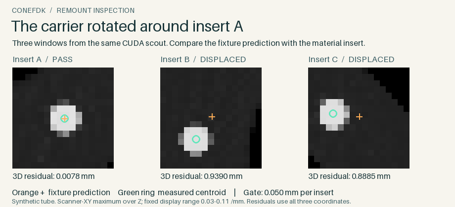

# 四颗定位球都对得上，为什么不能发布减薄结果？

一根带旧加工平面的模拟管件，换个姿态再扫，材料本身没有变化。只让承载四颗定位球的工装沿材料轴滑动 **0.80 mm**，四球拟合的最大残差仍只有 **0.00681 mm**，低于 0.035 mm 门槛。按这个位姿比较，原流程报出 **159 个超限单元**，甚至给出一处 **0.86713 mm** 的减薄峰值。读数来自两次扫描对错了位置，不是材料损失。

加上 `--witness` 后，位姿仍由这四颗球拟合，但**是否允许比较**还要看嵌在管件本体上的三个独立球心。上例中三点与预测位置相差 0.8031、0.8010、0.7885 mm；作业保留两次定位记录，不生成壳层、壁图或减薄报告。



上图直接来自[复核包](witness-pivot.zip)中三个 FP32 小窗。显示为沿扫描仪 Z 方向的最大强度投影；十字和圆环分别标出工装预测与观测的中心，底部读数按三维欧氏距离计算。A、B、C 对应清单内的 1、2、3。

## 通过和拒绝都要有对照

以下均为独立解析射线生成的管件投影，重建使用 RTX 5060 Laptop。径向壁厚减少 **≥ 0.30 mm** 才标记；见证点的 **0.050 mm** 是另一个门槛，决定坐标能否使用。

| 管件 / 工装状态 | 从投影得到的证据 | 作业输出 |
|---|---|---|
| 原样换姿态，无滑移 | 14,760 个有效点，最大绝对壁厚变化 0.03259 mm | 0 个超限 |
| 新增内壁凹槽，两次独立计数噪声 | 设计径向峰值 0.750 mm，测得 **0.77077 mm**，位于 134°；按减薄门槛比较的足迹 IoU 为 0.9564 | 1 个区域；同一对投影开、关见证检查，壳层、壁图和减薄报告逐字节一致 |
| 管件不变，工装轴向滑动 0.80 mm | 四球通过，三个本体见证点均超限 | 拒绝复检；关闭见证检查则出现前述 159 个虚假超限单元 |
| 工装绕穿过 A 的材料 Z 向直线转 4° | A、B、C 的残差分别为 **0.00776、0.93904、0.88845 mm** | 只查 A 会放行，查三点则拒绝 |
| 参考扫描缺少 B | A、C 通过；B 无可定位对象，残差为 `null` | 参考扫描即拒绝，不启动第二次定位，也没有壁图 |

在主对照中，重建后能定位的各见证球心相对射线设计位置，最大三维误差为 **0.01579 mm 以内**。这是已知几何的模拟误差；它与“能否支持四球位姿”的见证残差是两个量。

**0.050 mm 不是检出极限。** 另做三次无噪投影，只改变同一姿态下工装沿轴的平移。设计滑移 0.030、0.050、0.070 mm 时，最大见证残差分别为 **0.03452、0.05317、0.07130 mm**；第一个通过且没有超限壁厚单元，后两次拒绝。0.050 mm 工况中，同一次扫描的三个见证残差横跨门槛。软件比较的是各点实际观测残差，不知道设计滑移，也不能从这三例推断任意方向或噪声水平的检出概率。[临界区逐点读数](witness-margin.json)

## 算法做了什么，没有做什么

- 四球定位仍按原流程求解 `scanner = R × material + t`。三个见证体固定在**材料**而非可拆工装上，位于被检高度段之外。其标定位置须非共线，搜索窗不得相互重叠或覆盖工装球，见证球也不能进入测量壳层。卡具、管件和材料零度方向之间的关系须预先标定。
- 用该位姿预测各见证中心，**直接切取已有 GPU 侦察体**的小窗。示例体素 0.20 mm；球半径 0.50 mm，搜索半宽 1.65 mm。检查整个搜索窗在各视角的探测器内；在 CPU 上按 0.070/mm 阈值取 26 邻接域。域须唯一、不触窗边，体素量在球体标称量的 55%–145% 之间，三轴方差的最大/最小比不超过 1.8，再用超阈值强度的加权质心求三维偏差。缺失、多义、越界或残差超限均不能放行。
- **不使用见证体重新拟合位姿。** 重新拟合会改变我们正要检查的预测。参考与复检扫描各自三点全通过，才从投影生成第一张壁图。在带噪合格对照中，开关两种模式每次扫描都是一次侦察投影遍历、一次壳层遍历。检查会增加小窗的 CPU 处理；没有据此宣称总耗时变快。
- 清单记录扫描角色、预测与观测 XYZ、残差、状态、小窗父网格坐标和原始字节的 SHA-256。未观测到的球心不填零。原生 FDK、壁厚及减薄流程未改动；不传 `--witness` 仍运行仅四球模式。

## 复现

在项目根目录、已构建源码版并安装锁定依赖的 Windows 环境下：

```powershell
# 从探测器投影开始重做：7 组作业对照，加 3 次临界滑移；工作目录须是新目录。
python scripts/validate_witness.py --keep build/witness-local --reports build/witness-local/reports

# 只运行一次轴向滑移案例。该例预期退出码为 2；看 build/slip-job/manifest.json，不会有 material-loss.json。
python scripts/remount_loss.py build/witness-local/scans/reference build/witness-local/scans/slide fixtures/remount-fixture.json fixtures/remount-material.grid build/slip-job --witness fixtures/body-witness.json --level 0.02 --threshold 0.30 --radius 9.4

# 已发布的绕点转动案例：只需 Python 标准库，不需要 CUDA、NumPy 或 SciPy。
python -I -S scripts/witness_probe.py reports/witness-pivot.zip
```

复核脚本读取包内原始 FP32 值，核对清单与配置摘要，独立计算加权球心、工装预测位置和三个残差。它不重建投影，也不重复验证连通域形状；完整算法由上一条投影验收覆盖。全部依据：[七组作业记录](body-witness.json) · [门槛附近三组](witness-margin.json) · [完整回归与独立重放](witness-regression.json)。

**整套回归怎么核对？** 保留本仓库提交的历史 `reports` 不动。在另一个源码目录用 `Build.ps1 -VerifyRepeat` 连建两次，运行 `Run-Acceptance.ps1 -SkipBuild`；另选新目录分别运行 `validate_witness.py` 和 `validate_remount.py` 生成独立重放报告。最后从保留历史报告的源码目录运行：

```powershell
python scripts/check_witness_regression.py <完整验收报告目录> <见证检查重放报告目录> <四球重放报告目录> --out build/witness-check.json
```

核对对象包括原生 EXE/PTX、720 视角核桃 512³ 体、1296³ 压力体、原壁厚/孔径/找轴/减薄产物，以及本轮见证报告、临界区报告、小窗证据包和图。未启用见证检查的旧例仍保留原始报告：源码指纹和引用它的清单哈希自然会变，测量值和示例壁图包则要求不变。

**适用边界。** 这套检查回答的是“三个本体基准是否支持这次工装位姿”。任一点不符都应复查装夹、见证体和标定，不能仅凭残差断言一定发生了滑移。如果见证体和工装一起脱离材料、材料在三个基准之间局部变形，或位移低于当前分辨能力，通过也不是尺寸保证。本次没有带外部尺寸真值的实物管件；实测核桃只用于原重建链的回归验证。
