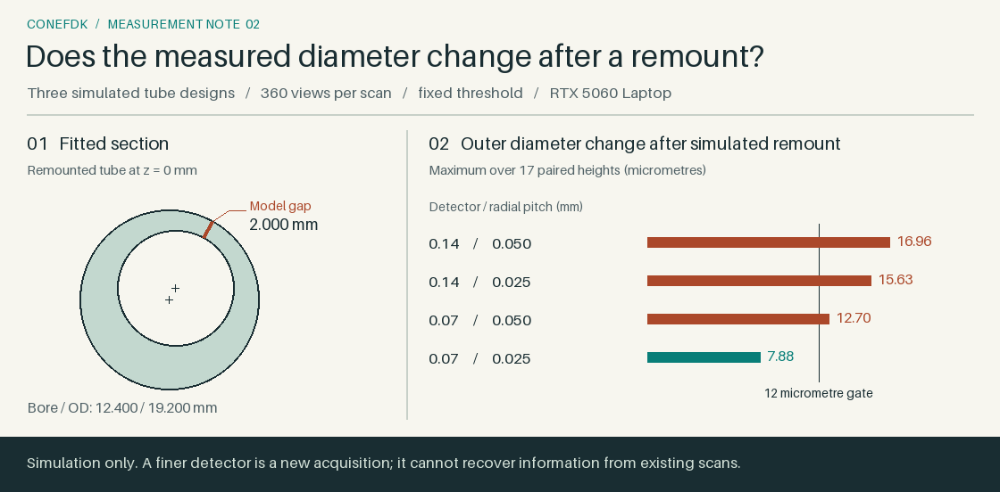

# Bore gauge · 换装夹位置后，内外径还一样吗？

`cone-fdk bore` measures a circular tube **one cross-section at a time** on the GPU. Unlike a radial distance measured from the supplied unwrap axis, the distance between the fitted inner and outer centers describes the part itself. This makes it possible to distinguish an off-center hole from a tube that is simply sitting off-center in the scanner.



## What changed when the part moved?

We used the **same** tube design (12.400 mm bore, 19.200 mm OD, 1.400 mm center offset) in two different tests:

- **Reframe:** reuse the exact nominal projections; shift the unwrap axis by (+0.40, −0.35) mm and rotate the seam by 37°. Reconstruct the atlas again. This is not another scan.
- **Simulated remount:** physically transform the *generating geometry* in the scanner plane by (+0.65, −0.45) mm and +63°, independently integrate new projections, then use a different unwrap axis and seam. The nominal and remounted projection hashes differ. No physical part was scanned.

Worst paired outer-diameter change across the 17 matching heights (not an average):

| Detector pitch / columns | Reconstruction radial step / shells | Reframe, same projections | Simulated remount | Remount gate ≤ 0.012 mm |
|---|---|---:|---:|---|
| 0.14 mm / 320 | 0.050 mm / 161 | 0.00505 mm | 0.01696 mm | Fail |
| 0.14 mm / 320 | 0.025 mm / 321 | 0.00073 mm | 0.01563 mm | Fail |
| 0.07 mm / 640 | 0.050 mm / 161 | 0.00955 mm | 0.01270 mm | Fail |
| 0.07 mm / 640 | 0.025 mm / 321 | 0.00129 mm | **0.00788 mm** | **Pass** |

Every comparison uses the same detector width, 360 views, axial pitch, threshold (0.02/mm), 360 azimuths and residual limit (0.025 mm). Within a detector setting both radial grids read the **same files**. Doubling horizontal detector sampling is a change to simulated acquisition, not an upsampling filter. The original setting failed first; the sampling study followed that failure without changing the 0.012 mm target. Only the last setting passed for both pose changes across **all four** dimensions: ID, OD, eccentricity and model minimum gap. This is a development study, not a blind accuracy trial.

## Compare against the design, not just the other scan

At the qualified setting, three distinct circular designs produced **85/85 measured sections** across five setups (including the two extra poses of the first tube). Worst absolute error over every row and setup:

| Quantity | Largest difference from analytic design |
|---|---:|
| Either fitted diameter | 0.007584 mm |
| Either 3D circle center (Euclidean distance) | 0.000457 mm |
| Eccentricity | 0.000365 mm |
| Minimum gap of the fitted circles | 0.004013 mm |

[Open the actual 17-row native JSON](bore-sections-example.json) for the qualified remount (its SHA-256 is the `sections_sha256` in the qualification record). For example, after remounting the first tube, at z = 0 the scanner-space centers are **(0.650100, −0.449804, 0)** mm outside and **(1.328654, 0.774488, 0)** mm inside. This gives a **1.399759 mm** offset and **1.999950 mm** model gap. On the genuinely concentric third design, the largest reported offset was 0.000157 mm, not mathematical zero. Quoted maxima are rounded up. A separate dense CPU least-squares solution on the *same reconstructed points* agreed within 1e−8 mm; that is an implementation check, not extra evidence about the physical edge location.

**Negative controls.** An elliptical bore (semi-axes 6.10 and 5.60 mm) had a measurable wall on every ray, yet the gauge rejected **17/17** rows at every setting. Its middle-row inner peak residual was 0.27345 mm at the qualified setting. A native test also dents just one outer-wall sample: RMS stays below the limit but peak residual exceeds it, so the row has no measurement. Another test removes one sample across the seam and expects `incomplete`, not an interpolated circle.

## Run it and audit a row

Build the current source ([install / build](../README.md#try-it)); `bore` is not in the archived v0.1.0 executable. The validation commands below set the CUDA DLL search path through the Python wrapper and need no download of scan data.

```powershell
$py = '.\.venv\Scripts\python.exe'
& $py scripts/validate_bore.py --keep build/bore-demo --reports build/bore-demo/reports
& $py scripts/bore_figure.py build/bore-demo/reports/bore-gauge.json build/bore-demo/plate.png
$dir = 'build/bore-demo/detector-2x_radial-2x'
(Get-Content "$dir/remounted.sections.json" -Raw | ConvertFrom-Json).rows[8]
```

On your own scan, first produce a single-wall map using [`--cylinder` → `wall`](RADIAL-WALL.md). Supply the **same grid** alongside that map; the raw `.wall` format is not self-describing. A mismatched grid with compatible dimensions/radii can pass structural checks and produce wrong world coordinates. Store and compare file hashes for external handoffs. With the CUDA dependencies on `PATH`:

```powershell
.\build\cone-fdk.exe bore --input radial.wall --cylinder grid.txt --output sections.json `
  --max-residual-mm 0.025 --budget 16 --ptx build/kernels.ptx
```

`--max-residual-mm` is required: choose a shape-departure cutoff appropriate for the application. It is not an uncertainty or an accuracy specification. The output is a `CFDK-bore-v1` JSON document. Each row records its axial offset from the grid center, valid-column count, status, residuals when available, and measurements **only** for accepted rows. The scanner-space center vector from outer to inner gives the offset direction; do not interpret its direction for a nearly concentric tube. Native stdout separately records GPU, tile count, byte counts, budget and redzone verification. The output is published atomically. The tests include corruption in a later tile, alias protection, Unicode paths, and byte-identical JSON across one- and multi-tile runs.

## Method and limits

One CUDA block fits one interface at one height in the orthonormal seam/tangent plane. The center is initialized from the first azimuthal harmonic. In FP64, deterministic reductions accumulate the Gauss–Newton equations for orthogonal distance to the circle. At each step the radius is the mean point-to-center distance; this leaves a 2 × 2 solve for the center. There are no fitted scanner-calibration or intensity corrections. Both circles must converge, nest, have **all** angular samples measured (minimum 32 columns), and satisfy the peak-residual limit; nothing is filled in. `incomplete`, `ill_conditioned`, `noncircular` and `not_nested` all give `measurement: null`.

For fitted radii `Ro` and `Ri` and center separation `e`, `model_min_gap_mm = Ro − Ri − e`. This is the shortest separation **between the two fitted circles in the section**. It is not the smallest observed pointwise wall thickness, a minimum 3D distance across a tilted surface, or proof that no flaw exists between samples. Use the [radial map](RADIAL-WALL.md) when the actual local minimum matters. The gauge does not locate or align the tube's axial direction; the simulated remount is in-plane, not a tilt test.

**下一步实物验收需要什么：** 带独立内外径和偏心量参考值的管件，以及重新装夹后的重复扫描。本次没有用真实核桃推断管件尺寸，没有验证噪声、束硬化、探测器标定偏差或批量生产公差。拟合残差很小也不能排除整个边界一起偏移。

[All four settings, design values, input/output SHA-256 and representative rows](bore-gauge.json) · [Full regression and independent replay](bore-regression.json) · [Projection generator and qualification gates](../scripts/validate_bore.py) · [CUDA kernels](../src/kernels.cu) · [Native I/O](../src/bore.hpp)
