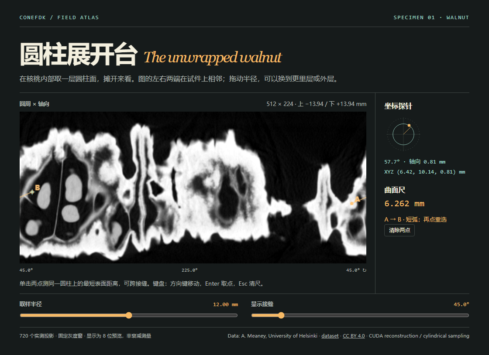

# Cylindrical CT atlas · 圆柱展开台

A longitudinal plane only intersects a ring in two places. This mode follows a chosen radius through **all 360°** and shows axial position vertically. Its native CUDA kernel evaluates FDK directly on that sheet. The input is the projections; no intermediate cube, surface mesh or trilinear reslice is used.



**[Save the offline viewer](walnut-cylinder-atlas.html)** (on GitHub, use **Download raw file**, then open the saved HTML). Drag radius to move through the specimen. Drag the display seam to center a structure previously split between opposite edges. Hover to read scanner XYZ in mm; two clicks measure the shortest path constrained to that radius. The example ruler in the screenshot measures two selected sample locations, not a labelled defect. Moving the seam preserves the pins; changing radius clears them. Arrow keys move one sample, Enter places a pin, Esc clears. The preview uses a single 8-bit window for all radii; use the native FP32 output for attenuation analysis. The display aspect is in samples, not an equal-mm drawing.

## Reconstruct your own sheets

Build the current source; the v0.1.0 binary predates this mode. After `Demo.ps1`, the bundled 90-view fixture is enough to try this command (the published atlas uses the separate 720-view scan):

```powershell
.\.venv\Scripts\python.exe scripts/reconstruct.py data/walnut-corrected map.f32 --n 512 --fov 40 --budget 48 --planner min-passes --cylinder fixtures/walnut-cylinder.txt
```

The [manifest](../fixtures/walnut-cylinder.txt) has five whitespace-separated records (no inline comments):

```text
CFDKCYL1 512 224 11
0 0 0
0 0 1
1 0 0
7 1 0.125
```

1. `W H D`: number of azimuth columns (3–4096), axial rows and radii (1–4096).
2. `C`: XYZ scanner position of the axis midpoint, mm.
3. `A`: unit vector of increasing row.
4. `U`: radial unit vector at column zero. `A` and `U` must be perpendicular. Lengths and dot product are checked to `1e-6`, then normalized / orthogonalized; the native JSON records the frame actually used.
5. First radius, positive outward radial step (may be zero for one shell), positive row pitch, in mm. Radius must be positive. The entire continuous cylinder envelope through the first and last row centers must fit within the scanner FOV cube.

For zero-based `(k,j,i)` let `r=r_first+k·dr`, `t=(j−(H−1)/2)·pitch`, `θ=2πi/W`, `V=A×U`. The scanner location is `C+tA+r(cosθ·U+sinθ·V)`. There is no duplicate endpoint at 360°. Neighbouring columns are `2πr/W` mm apart **along the surface**; this changes with radius. For two points on the same radius the ruler returns `hypot(r·wrap(Δθ), Δt)` where the angle is wrapped to `[−π,π)` in radians. It does not measure the straight 3D chord or a path on the actual material boundary.

Output is little-endian FP32 with azimuth contiguous: `np.fromfile("map.f32", "<f4").reshape(11, 224, 512)`. Keep the manifest or native JSON (`shape_rha`, frame and pitches) with the raw file. `--n` is the parent reference grid, not map resolution. Cylinders cannot be combined with ROI, plane, stack or `--stack-format nrrd`: a single Cartesian affine cannot encode this grid. Each resident row tile shares the existing filtering path; budget splits may fall inside a shell. A failed reconstruction does not publish a partial output.

## What was verified

| Check on Windows GPU | Result |
|---|---|
| Measured Helsinki walnut, 720 views; 11 radii × 224 rows × 512 azimuths | 1 projection read at 128 MiB; 5,046,272 output bytes. Independent native reconstruction with the seam rotated 90° matched a cyclic shift **byte-for-byte at all 1,261,568 samples**. |
| Tight memory, same input and request | At 46 MiB, batch-first split a shell and read projections twice; min-passes used 8 views/batch and read once. Both payloads matched the 128 MiB output. |
| Independent FP64 spatial convolution and explicit source/detector rays | 814 points over every layer, including both sides of the seam; relative L2 **2.270×10⁻⁶**, max absolute error / reference peak **3.762×10⁻⁶** (limits 10⁻⁵ and 5×10⁻⁵). |

**A deliberately split analytic target.** The 180-view analytic input contains a sphere of radius 1.6 mm centered at `(1.7, 4.1, 3.4)` mm. Its center azimuth is 2° from the chosen seam. At each radius the fixed half-contrast mask crosses both image edges. We located its center with the circular mean of azimuth and mean axial coordinate, and counted occupied columns on the sphere-center row. With sphere center at distance `r₀` from the axis, the exact width on a radius `r` is `2r·acos((r²+r₀²−R²)/(2rr₀))`. No alignment or threshold fit.

| Radius (mm) | Center error on sheet (mm) | Expected arc (mm) | Observed arc (mm) | Absolute difference (mm) |
|---:|---:|---:|---:|---:|
| 3.6385 | 0.00255 | 2.52173 | 2.47663 | 0.04510 |
| 4.4385 | 0.00666 | 3.21758 | 3.21483 | 0.00275 |
| 5.2385 | 0.00190 | 3.02115 | 2.97143 | 0.04972 |

These are errors on a known **simulation** (limits 0.06 mm center and 0.15 mm arc). The walnut experiment checks numerical consistency on measured projections; it has no calibrated dimensional ground truth. A pipe or bore with known axis is a natural candidate for this view, but no industrial part was qualified here. An irregular exterior following the actual material boundary would require a different surface model.

### Replay

```powershell
.\.venv\Scripts\python.exe scripts/validate_cylinder.py phantom
.\.venv\Scripts\python.exe scripts/validate_cylinder.py walnut
```

These commands use the prepared, hash-checked scans from `Run-Acceptance.ps1`; `--scan` accepts another prefix for the **same pinned input**, `--reports` changes the output folder. The walnut stage also generates the standalone HTML. For optional browser replay, install Python `playwright` in a development environment and run `scripts/check_cylinder_atlas.py reports/walnut-cylinder-atlas.html --browser <path-to-Chromium-executable> --screenshot atlas.png`. It checks actual canvas pixels against decoded PNGs, a one-column cross-seam ruler, scanner coordinates, keyboard, sliders, mobile width and offline operation.

[Measured data and native accounting](cylinder-walnut.json) · [Analytic target per radius](cylinder-phantom.json) · [Build and full-suite regression](cylinder-regression.json) · [Native negative and tilted-frame tests](../tests/test_cylinder.py). Measured data: Alexander Meaney / University of Helsinki, CC BY 4.0; reconstruction, unwrapping and fixed-window preview are adaptations; [provenance and license](../NOTICE.md).
