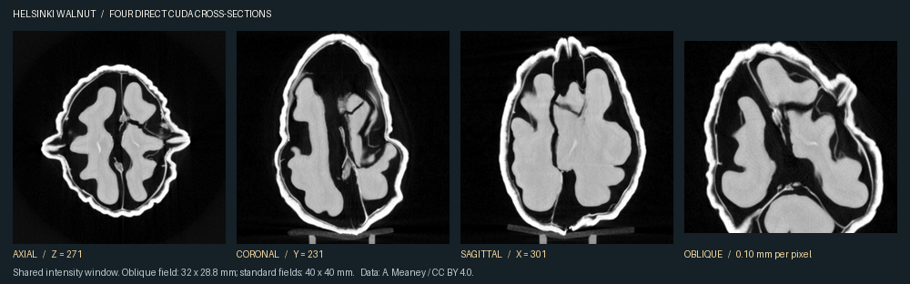

# Direct reconstruction of an arbitrary cross-section

`--plane` reconstructs one oriented image from the original projections. Use it when the surface you want to inspect does not line up with the scanner axes, or when saving an entire volume just to extract one slice is unnecessary. The GPU filters each view batch as in the volume engine, then backprojects onto the requested physical pixel centers. There is no intermediate volume or 3D image interpolation.



*Helsinki walnut, 720 measured projections. All four images share one display window; their fields of view differ. The image on the right is a translated plane tilted in all three world axes. Data: Alexander Meaney, University of Helsinki, CC BY 4.0; [processing and attribution](../NOTICE.md).*

## Reproduce one image

Build from the current source; the v0.1.0 binary does not have `--plane`. After `Demo.ps1`, use `data/walnut-corrected` to try the included **90-view offline** scan. The **720-view** report uses `data/full-corrected`, produced by the full acceptance run.

```powershell
.\.venv\Scripts\python.exe scripts/reconstruct.py data/walnut-corrected cut.f32 --n 512 --fov 40 --budget 128 --plane fixtures/walnut-oblique.txt > cut.json
```

`cut.f32` is little-endian FP32 attenuation in mm⁻¹, stored row-major, with no header. Keep the JSON with it: `shape_yx` gives `[height,width]`; `center_mm`, `col_step_mm`, `row_step_mm` carry the orientation and placement. For example, to read the quantitative image and create an 8-bit preview in Python:

```python
import json
from pathlib import Path
import numpy as np
from PIL import Image

meta = json.loads(Path("cut.json").read_bytes())
image = np.fromfile("cut.f32", "<f4").reshape(meta["shape_yx"])
lo, hi = np.percentile(image, [2, 99])
Image.fromarray((255 * np.clip((image - lo) / max(hi - lo, 1e-12), 0, 1)).astype("u1")).save("cut.png")
```

### Specify a cut in world coordinates

The [checked-in example](../fixtures/walnut-oblique.txt) is plain text:

```text
CFDKPLANE1 320 288
1 -1.25 0.75
0.08 0.06 0
-0.036 0.048 0.08
```

1. Width and height in pixels: each 1 to 4096.
2. Image **center** in XYZ millimetres, relative to the scanner isocenter. For an even dimension the center lies between pixels.
3. XYZ displacement in mm for one step to the **next column**.
4. XYZ displacement in mm for one step to the **next row**.

For zero-based `(row=j, col=i)` the pixel center is `center + (i - (width-1)/2) * col_step + (j - (height-1)/2) * row_step`. The nonzero steps must be orthogonal (absolute normalized dot product ≤ 1e−5); lengths may differ and signs set orientation. Every pixel center must lie inside the `--fov` cube; out-of-bounds requests are rejected, not clipped. `--n` identifies the nominal parent grid, not the plane pitch. Changing `--n` alone does not move the plane. A smaller pitch does not increase the resolution of the acquired data.

`--plane`, `--stack`, `--roi` and `--roi-list` are mutually exclusive. If the pixel array does not fit the buffer budget, the engine writes horizontal strips in row order and rereads/refilters all views for each strip. It must fit the filter workspace, at least one view, and one output row. Metrics include actual read bytes, passes, and peak engine-owned device allocation (not total VRAM use). For parallel, evenly spaced planes, [use one `--stack` job](OBLIQUE-STACK.md); unrelated planes require separate jobs.

## Three different accuracy questions

| Check on Windows GPU | What was compared | Result |
|---|---|---|
| Are standard views oriented and indexed correctly? | Direct 512 × 512 cuts vs. raw bytes of the frozen 512³ walnut, at Z=271, Y=231, X=301 (zero-based). | **786,432 / 786,432 pixel bit patterns matched.** This is a compatibility check with the volume engine, not an independent physical measurement. |
| Does the tilted plane evaluate FDK at the declared points? | On the measured walnut: independent FP64 spatial Ram-Lak convolution, explicit source/detector intersections, zero-extended interpolation at 365 points distributed across the 320 × 288 plane, using all 720 views. Small asymmetric synthetic scans also test entire planes, including partial detector edges. | Walnut relative L2 **1.6442 × 10⁻⁶** (limit 1 × 10⁻⁵); maximum absolute difference / reference peak **3.0769 × 10⁻⁶** (limit 5 × 10⁻⁵). These are intensity differences, not dimensional errors. |
| Does a known feature have the expected geometry in the image? | Three orientations through a 1.6 mm-radius sphere in a separate, analytically projected phantom. Signed offsets 0, +0.60 and −0.85 mm; pixel spacing 0.05 × 0.075 mm. Fixed half-contrast threshold; no scale or pose fit. | Worst 3D center distance **0.00529 mm**; worst area-equivalent diameter error **0.02867 mm**, under the respective 0.06 / 0.10 mm gates. This is a simulation, not a tolerance for real parts. |

The measured tilted image writes **360 KiB** instead of the **512 MiB** full parent. It still reads all 238,694,400 projection bytes once at the tested 128 MiB budget. This compares **output sizes**, not acquisition dose, input size or processing speed. In the small-geometry strip test a 1 MiB budget forces multiple passes; the result matches a single pass bit-for-bit, including after mirroring the column direction.

The full Windows GPU suite passed **95 tests**, with no skips. Two clean builds produced identical EXE and PTX files. The unchanged 512³ walnut and 1296³ stress outputs still match their frozen SHA-256 hashes.

[Walnut metrics, affine vectors and hashes](direct-planes.json) · [Analytic phantom measurements](direct-planes-phantom.json) · [Regression and rebuild record](direct-planes-regression.json) · [Plane GPU tests](../tests/test_plane.py) · [FP64 reference implementation](../scripts/spatial_oracle.py)

`Run-Acceptance.ps1` runs all checks from source. To replay only the two dataset checks after preparing the inputs:

```powershell
.\.venv\Scripts\python.exe scripts/validate_planes.py
.\.venv\Scripts\python.exe scripts/validate_plane_phantom.py
```
