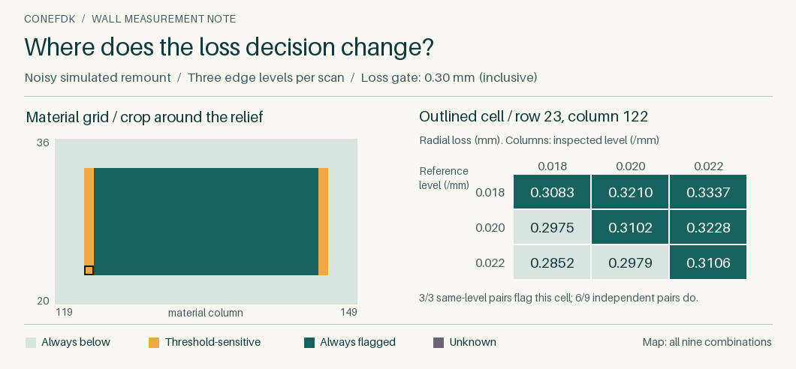

# 换个边缘阈值，这个位置还算减薄吗？

在同一根带内凹的模拟管上，标称设置报出 **263 个**超限单元。把基准扫描和复检扫描的边缘阈值各取三档，只有 **253 个**在九种组合下都超限。另有 **22 个**会随设置翻转：其中 10 个原本超限，12 个原本未超限。平时若只试“两次扫描用同一档”的三种组合，会看到 1 个敏感点，遗漏另外 21 个。



黑框内单元位于材料网格第 23 行、第 122 列（从 0 数起）。三组同档读数都超过 0.30 mm；九组独立配对的最小、最大值分别为 **0.28523 和 0.33365 mm**。这个位置应标注为“对阈值敏感”，不能把标称读数 0.31015 mm 当成决定性的证据。[九组未取整的读数](edge-cell.json) · [整个 41 × 360 网格的 CPU 复核包](edge-review-example.zip)

## 两个门槛，不同的问题

固定减薄判据为 `基准径向壁厚 − 复检径向壁厚 >= 0.30 mm`。改变的是**从 CT 灰度定位内外边界**用的衰减阈值：0.018、0.020、0.022 /mm；每次扫描可以独立选一档。管件本体见证点、工装位姿、材料网格和投影都没变。

| 来源与设置 | 始终未超限 | 随设置翻转 | 始终超限 | 不可判 |
|---|---:|---:|---:|---:|
| 同一管件、原样换装复扫，三档 | 14,760 | 0 | 0 | 0 |
| 另一姿态加工内凹，两次投影各加独立计数噪声，三档 | 14,485 | 22 | 253 | 0 |
| 原样复扫，故意把第二档设在材料平台附近（0.020、0.040 /mm） | 0 | 0 | 0 | 14,760 |

内凹的解析几何在该网格上有 **275 个**设计超限点：本例中 253 个落在始终超限区，22 个落在阈值敏感区。不可判对照则是另一回事：只要某次扫描在任一档没有唯一有效的壁厚，就不报该点的上下界。不能因为标称档仍有数值就把它计为“始终未超限”。工装滑移、本体见证缺失和未启用见证的历史作业也分别试过，均不生成复核结果。[设计交叉表、拒测对照和原始记录](edge-qualification.json)

## 在自己的作业上运行

使用从当前源码构建的 Windows 版；原发布包 v0.1.0 不含此流程。输入须是已完成的 `remount_loss.py --witness` 作业。可以有局部壁厚不可测，但两次扫描的本体见证点必须全部通过。保留父作业中的壳层、标称壁图、网格、见证配置、减薄报告及清单；不需要再打开投影和侦察体。

```powershell
# 用模拟投影生成父作业，并一次完成原有见证验收和新复核；使用新目录。
python scripts/validate_witness.py --edge-review --keep build/witness-edge --reports build/witness-edge/reports

# 对一个已通过见证检查的父作业，另建复核目录；可加 --parent-sha256 指定独立保存的父清单摘要。
python scripts/edge_review.py build/witness-edge/noisy-change build/my-edge-review --levels 0.018 0.020 0.022

# 只看一格：在自己的复核目录或解压后的示例上均可。Python 3.12 标准库即可，无需 GPU。
Expand-Archive reports/edge-review-example.zip -DestinationPath build/edge-example
python -I -S scripts/edge_probe.py build/edge-example --row 23 --column 122
```

阈值列表支持 2–16 个互异的正有限数，必须包含父作业的标称值。三档时两张标称图直接复用，只额外执行 **4 次原生 CUDA `wall`**，新增投影遍历为 **0**。每个单元的最小可能减薄量为 `min(基准各档壁厚) − max(复检各档壁厚)`，最大值反之；所有档位有效时，这两个值就是完整配对集合的端点，不需要物化九张减薄图。运算使用 FP64，不在分类前四舍五入。这里报告的是省掉的遍历和调用，不是端到端加速倍数。

## 复核文件和验收口径

- 作业清单最后才发布；输入被锁定并核对 SHA-256，当前 EXE/PTX 必须与父作业一致；标称分类还逐格核对原生减薄报告的行程记录。输入来自外部时，用可信渠道获取 `--parent-sha256`：清单内自带的哈希不是签名。当前复核器不接收超过 32 MiB 的父减薄 JSON；不做截断。目标目录须是父作业以外的新目录。
- `class.u8`、`min-loss.f64`、`max-loss.f64` 都按材料行、方位列存放（行优先，列连续）；浮点数为小端。分类码依次是 0 始终未超限、1 敏感、2 始终超限、3 不可判。不可判的两个界为 NaN。随包保留每档两侧的原生壁图及无效原因；逐点工具会核对所读文件摘要、重新枚举所有组合并检查保存的边界和标签。复核命令退出 0 表示每格都能判，2 表示报告有效但含不可判点；两者都**不是**对工件质量的放行。
- 独立 CPU 验收从两次扫描的 FP32 壳层逐条重找交点，不读取 CUDA 半径作为真值。三种工况合计核对 **236,160 条壁厚记录、324,720 次配对判定**；逐点类别完全一致，有限壁厚相差最多约 3.11 × 10⁻¹⁵ mm。这是两种实现对同一采样数据的数值一致性，**不是物理测量误差**。[整套回归与复核包哈希](edge-regression.json)

复现整套回归时，在隔离的源码目录运行 `Build.ps1 -VerifyRepeat`、`Run-Acceptance.ps1 -SkipBuild`（不传 `-CoreOnly`）。另外从一套保留的见证作业重跑 `validate_edges.py`，再将两套报告与发布过的父作业记录比较：

```powershell
python scripts/validate_edges.py build/witness-edge build/edge-replay --reports build/edge-replay/reports
python scripts/check_edge_regression.py reports build/edge-replay/reports --out build/edge-regression.json
```

**适用边界。** “始终”只覆盖给定的离散阈值组合。该试验不提供连续范围的保证，也不估计阈值发生概率、置信区间、空间分辨率或实物仪器精度。若两次扫描的标定误差已知完全相关，则同档配对回答的是另一个合理的问题；独立配对用于检查两次边缘选择可能不一致时的后果。地图逐点汇总，不能据此假设每个位置的最坏值一定来自同一组全局设置。
