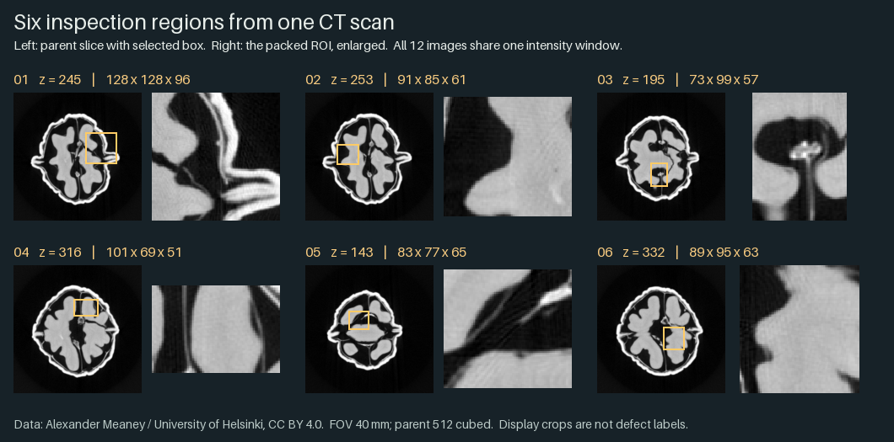

# One scan, six regions · 多位置批量复核



Each yellow box is shown on the corresponding axial slice of the 512³ parent. The image to its right is read from the **multi-region output**, not copied from the overview. All panels use the same intensity window. Source: Alexander Meaney / University of Helsinki, [walnut dataset](https://doi.org/10.5281/zenodo.6986012), CC BY 4.0. ConeFDK processed the projections and scaled the previews. The boxes are inspection locations, not defect labels.

## 同一份工作，分六次还是一次做？

同一试件如果已有几个待复查的位置，逐个启动 `--roi` 会对相同投影重复做锥束加权、FFT 滤波和插值系数准备。`--roi-list` 让每批滤好的投影留在 GPU 上，依次反投影到当前能放下的所有选区。结果按清单顺序写到一个带坐标索引的文件；不必生成完整体或靠文件名记住位置。

| Windows GPU；720 角，512³ 父网格，40 mm 视野，batch 16，128 MiB 预算 | 顺序启动 6 个 `--roi` | 一次 `--roi-list` |
|---|---:|---:|
| 六组交替运行，整批进程耗时中位数 | 1.805 s | **0.351 s** |
| 应用读取 / 处理整套投影的遍数 | 6 | **1** |
| 投影读取字节（不等于物理磁盘流量） | 1,432,166,400 | 238,694,400 |
| 滤波批次 / 反投影 kernel 调用 | 270 / 270 | **45** / 270 |
| GPU 滤波事件总时间中位数 | 251.3 ms | 40.1 ms |
| 引擎自有设备缓冲峰值（串行取最大，不累加） | 48.07 MiB | 56.41 MiB |

整批 **5.15×**，六组均更快。两种方式**都计算同样的六个选区**；串行列是六次原生进程耗时之和，批量列是一个原生进程。均含启动、读入验证、GPU 计算、写出和原子替换，不含 Python 哈希、提取和制图。各预热一次，交替 AB/BA，不清系统缓存、不锁频。加速来自少启动进程、少读入和少滤波等；这不是反投影内核本身的 5.15 倍加速。峰值多用约 8.34 MiB 来同时保留这组六个输出。

**精度验收：**本次还重新生成了整个 512³ 体，并核对其 SHA-256 与已发布参考一致。六轮中，每个选区的独立输出和批量包内对应字节区间的 SHA-256 都等于完整体同坐标裁剪的 SHA-256；六个包也有相同的整包哈希。把预算降到 **48 MiB** 后需要 **3 遍**，峰值 **47.95 MiB**，整包仍逐字节相同。没有为这个实测核桃建立缺陷真值；这些检查回答的是重建数值和坐标是否保持一致。

- [每轮读入量、GPU 时间、内存和哈希](multi-roi-walnut.json) · [六个选区的坐标](../fixtures/walnut-six-rois.txt) · [复现脚本](../scripts/validate_roi_pack.py)
- [1296³ 原有完整体路径复测](multi-roi-full-compatibility.json)：复用新调度器写出整件，比较全文件 SHA-256，并用 ASTRA 抽查五层。
- [整套回归 74 项通过（JUnit）](multi-roi-tests.xml)；其中[多选区与文件格式测试](../tests/test_roi_pack.py)覆盖 1/256 个选区、自动缩减批次、重叠/重复/边界选区、奇数尺寸、尾批、强制切层、非法清单和损坏索引；失败不替换已有包。精度比较限于相同输入和已测配置，不承诺不同 GPU 或不同实际 FFT 批次下浮点字节完全一致。

后续优化：上述 48 MiB 的三遍是默认策略的结果。可选的 `--planner min-passes` 在同一预算下做到了单遍；[新的同机对照与七档预算](ROI-PLANNER.md)。

## Run it from a source build

Use a Windows source build and its locked Python environment. The v0.1.0 binary predates region selection. After `Demo.ps1`, `data/walnut-corrected` is the **90-view offline fixture**. The same boxes can be used for an immediate smoke test without the 720-view download:

```powershell
$py = '.\.venv\Scripts\python.exe'
& $py scripts/reconstruct.py data/walnut-corrected build/six.croi --n 512 --fov 40 --budget 128 --batch 16 --roi-list fixtures/walnut-six-rois.txt
& $py scripts/roi_pack.py list build/six.croi
# Extract the first region into a NEW directory. No CUDA needed for extraction.
& $py scripts/roi_pack.py extract build/six.croi 0 build/first-region
& $py scripts/export_volume.py build/first-region/volume.f32 --layout build/first-region/layout.json --out build/first-region --source-note 'Alexander Meaney / University of Helsinki, CC BY 4.0'
```

`volume.f32` and `volume.mhd` retain the original grid coordinates; `roi-viewer.html` contains display previews. For the table above use **`data/full-corrected`**, prepared by full acceptance, and run `scripts/validate_roi_pack.py --scan data/full-corrected`. That script temporarily needs space for a full reference (512 MiB) plus the outputs. Normal `--roi-list` runs do not write that reference.

## Native I/O contract

- Replace `--roi` with `--roi-list boxes.txt`. List: one `x,y,z,nx,ny,nz` per line on the parent `--n` grid, zero-based; blank lines and whole-line `#` comments allowed; UTF-8 with optional BOM. From 1 to 256 boxes, at most 64 KiB. Overlap and repeated boxes are legal and each gets its own payload. Order is preserved, not rearranged for optimal bin packing.
- `--budget` limits engine-owned device buffers, including the FFT work area and allocation borders; it does not cap driver/context memory. Batches and adjacent boxes are planned within the budget. A box too deep for one pass is streamed in whole XY planes; it is rejected if even one plane plus minimal filter storage cannot fit. Each pass rereads the **entire** scan. A tiny box is not a detector crop.
- Normal full-volume and `--roi` outputs remain headerless FP32. **Only** `--roi-list` writes `CFDKROI1`. The native pack is published by the same flush-and-replace path, with the index and all payloads inside one file. Do not treat the whole pack as a raw image.
- On disk: ASCII `CFDKROI1` (8 bytes); little-endian `uint32 n`, `float32 voxel_spacing_mm`, `uint32 count`; then `count` records of six little-endian `uint32` coordinates/sizes. First payload offset is `20 + 24*count`. Payloads are tightly packed little-endian FP32 in `[z,y,x]` order without padding; each takes `4*nx*ny*nz` bytes. A voxel center is `(origin + local_index - (n-1)/2)*voxel_spacing_mm` along each axis.
- `roi_pack.py list` checks extents and exact file length without loading voxels; `extract` seeks directly to the requested zero-based region and copies in bounded chunks. The extraction emits the payload SHA-256 and a layout JSON for `export_volume.py`. Length/index checks are not checksums: compare a trusted digest when verifying transferred files.
