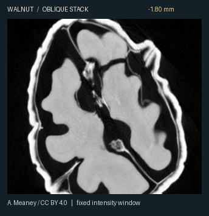

# Follow a structure through an oblique stack

`--stack` reconstructs a rectangular subvolume whose axes can be tilted relative to the scanner. For a shell or a bond line, set the column and row directions along the surface and step across it in depth. The output contains attenuation values at those physical locations; it is not an interpolation of an already-reconstructed cube. No parent volume is needed to run the command.



*21 distinct slices, played forward and back with one intensity window. Centers are 0.18 mm apart; the first and last lie 3.60 mm apart. Display only. Projections: Alexander Meaney / University of Helsinki, CC BY 4.0; [attribution and processing](../NOTICE.md).*

## Run it

Build the current source with `Build.ps1`. The v0.1.0 release executable does not have this mode. After `Demo.ps1`, try the included 90-view scan:

```powershell
.\.venv\Scripts\python.exe scripts/reconstruct.py data/walnut-corrected tilted.nrrd --n 512 --fov 40 --budget 48 --planner min-passes --stack fixtures/walnut-stack.txt --stack-format nrrd
```

The result is one self-contained NRRD: raw little-endian FP32 values with the first voxel's position, three direction vectors and units (mm) in the header. The coordinate system is the scanner's right-handed XYZ, not patient anatomy. The file is published in one rename after validation and flush. For headerless output use `--stack-format raw` (default); the extension does **not** select the format. For example, read a raw output as `np.fromfile('tilted.f32', '<f4').reshape(21, 288, 320)`. The same array can be read from the NRRD with `nrrd.read('tilted.nrrd', index_order='C')[0]` using the optional `pynrrd` reader. The native writer does not depend on it.

### Define the sampling grid

The [example manifest](../fixtures/walnut-stack.txt) is plain text:

```text
CFDKSTACK1 320 288 21
1 -1.25 0.75
0.08 0.06 0
-0.036 0.048 0.08
0.0864 -0.1152 0.108
```

The first line gives **width, height, depth** (each 1–4096). The next four lines give the **center of the whole stack**, then the displacements to the next column, row and layer, respectively, in scanner XYZ millimetres. The example pitches are 0.10, 0.10 and 0.18 mm. Negative directions and unequal pitches are valid. The three steps must be nonzero and mutually orthogonal (absolute normalized dot product ≤ 1e−5). All eight voxel-center corners must be inside the `--fov` cube. `--n` only sets the nominal parent spacing; it does not set the stack's pitches. A smaller pitch does not establish higher scanner resolution.

For zero-based column `i`, row `j` and layer `k`, the physical point is:

```text
center + (i - (width-1)/2)*col + (j - (height-1)/2)*row + (k - (depth-1)/2)*layer
```

JSON `shape_zyx` is storage order `[depth,height,width]`, **not scanner axis order**. `data_offset_bytes` is zero for raw or the header length for NRRD. `output_bytes` includes the header, if any. `--stack` cannot be combined with `--plane`, `--roi` or `--roi-list`. To inspect nonparallel or unevenly spaced sections, use separate `--plane` jobs.

## What was verified on the Windows GPU

| Check | Observed result |
|---|---|
| Same tilted grid, two routes | All **1,935,360** FP32 voxel bit patterns matched 21 individually launched `--plane` jobs. The center layer also matched the frozen pre-stack hash. |
| Shared projection data | At 128 MiB and batch 16: **238,694,400 bytes read once**, versus **5,012,582,400 bytes** for the serial planes. This counts application reads, not physical disk traffic or a 21× wall-time claim. Raw output: 7,741,440 bytes. |
| Interior seams at 48 MiB | Default: 16 views/batch, 4,857 rows in the first pass, **two** full reads. `min-passes`: 8 views/batch, **one** read. Both outputs had the same full SHA-256 as the 128 MiB output. The cap covers engine-owned buffers, not driver/context memory. |
| Independent calculation | Across all 21 layers, **630** locations compared with CPU FP64 spatial convolution and explicit ray geometry, all 720 views. Relative L2 **1.9862 × 10⁻⁶** (limit 1 × 10⁻⁵); max absolute difference / reference peak **6.4442 × 10⁻⁶** (limit 5 × 10⁻⁵). This compares intensities, not dimensions. Small synthetic grids are also checked in full. |
| Orientation and interchange | A second, axis-permuted and reversed 61 × 54 × 9 grid matched **29,646** reindexed voxels of the frozen 512³ parent. A separate `pynrrd` 1.1.3 replay checked the tilted stack's entire payload, first-center position, axis vectors and units. |
| Known-size 3D object | On separate **analytic** projections, reconstructed a 3.20 mm-diameter sphere on a rotated 0.06 × 0.07 × 0.08 mm grid. Fixed half-contrast segmentation gave **16.8491 vs 17.1573 mm³** (1.796% low, limit 3%), centroid error **0.00233 mm** (limit 0.05 mm), equivalent diameter **3.18072 mm** (error 0.01928 mm; limit 0.05 mm). No pose, scale or threshold fitting. These are simulated-object results, not a dimensional tolerance for real parts. |

The planner treats all layers as one ordered stream of rows. It can split within a layer, then continue from that exact row on the next pass. Within each pass, cuFFT filters each view batch once; the existing CUDA plane kernel accumulates each resident layer segment in its original view order. More layers still require more backprojection work. This mode targets parallel, uniformly spaced planar sections, not curved-surface reformatting or defect segmentation.

[Measured output, I/O and hashes](oblique-stack.json) · [Analytic sphere record](oblique-stack-phantom.json) · [Full regression and repeat-build record](oblique-stack-regression.json) · [Boundary and numerical tests](../tests/test_stack.py)

`Run-Acceptance.ps1` runs the sphere check in the core suite and the measured scan in the full suite. To replay on prepared inputs:

```powershell
.\.venv\Scripts\python.exe scripts/validate_stack.py phantom
.\.venv\Scripts\python.exe scripts/validate_stack.py walnut
# Optional reader round-trip: install pynrrd==1.1.3 in the test environment, then add --check-pynrrd.
```
