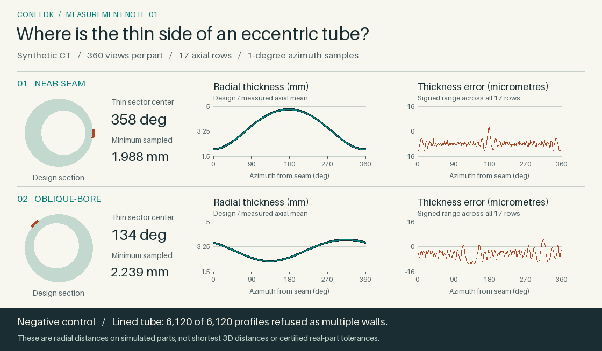

# Radial wall thickness · 偏心管壁厚

**Question:** given a tube axis and an attenuation level, where is the thin side? `cone-fdk wall` measures along scanner-space rays from the supplied axis, then searches circular sectors. For the first tube below the thin side straddles the 0°/360° display seam. It is one sector, not two defects.



| Simulated part | True minimum / measured point minimum | Thin-sector center: design / measured | P95 / worst absolute thickness error |
|---|---:|---:|---:|
| Outer radius 9.60 mm; bore radius 6.20 mm; offset 1.40 mm | 2.000 / 1.988 mm | 358° / 358° | 0.01165 / 0.01322 mm |
| Outer radius 8.80 mm; bore radius 5.80 mm; offset 0.75 mm | 2.250 / 2.239 mm | 134° / 134° | 0.01006 / 0.01065 mm |
| First tube plus an air gap and a second wall at radii 3.90–4.40 mm | No single-wall answer | None | 6,120 / 6,120 profiles rejected as `multiple` |

**怎么读这些数：** 点最小值是所有有效位置里最薄的一点；扇区是对一段圆周及全部选定高度取均值，两者不同。表中误差是各点测得的厚度减去**该角度**的设计厚度，再取绝对值统计。两件正例分别比较 17 × 360 = 6,120 个位置。即使方向命中，扫描仍按 1° 采样，不代表无限角度精度。

### Follow one number back to the signal

At height 0 mm and 358° in the first tube, the signal crosses the level 0.02/mm between radii **7.60 and 7.65 mm** on entry and **9.55 and 9.60 mm** on exit. Interpolation puts the edges at **7.603221 and 9.591150 mm**: their difference is **1.987929 mm** versus the 2.000 mm design. The lined tube at the same location has crossings at **3.894, 4.396, 7.604 and 9.591 mm**; the record contains no thickness. In the second positive case the lowest individual pixel is at 135°, while the lowest complete 15-column sector is centered at 134°. The sector statistic is not the azimuth of a single pixel.

## Reproduce and audit a measurement

Build the current source as in the [main README](../README.md); the historical v0.1.0 binary has no `wall` command. No scan download is needed for these examples. In a fresh output directory:

```powershell
$py = '.\.venv\Scripts\python.exe'
& $py scripts/validate_wall.py --keep build/tube-demo --reports build/tube-demo/report
& $py scripts/wall_probe.py build/tube-demo/near-seam-atlas.f32 build/tube-demo/near-seam.wall build/tube-demo/near-seam.json --row 8 --column 358
```

The second command needs only Python/NumPy. It reads one ray from the **saved FP32 reconstruction**, locates the threshold brackets independently on the CPU, and checks the status and dimensions against the native map. It prints both bracketing attenuation samples, the interpolated radii, their scanner XYZ coordinates and the full radial signal. The [three saved probe traces](radial-wall-probes.json) include two point minima and the double-wall rejection; compare the two crossings in a valid ray with the four in the lined tube. It checks the selected ray, not the identity of an entire file: keep the matching manifest, JSON and file hashes.

For your own atlas, choose a radial range that samples background on **both** sides and an attenuation level justified by your scan. Do not copy the demo threshold into an uncalibrated scan. The first command below uses the pipeline's [cylinder manifest](CYLINDER-ATLAS.md); `grid.txt` must match the raw atlas exactly. Angle zero and increasing height are set by that manifest.

```powershell
& $py scripts/reconstruct.py data/my-scan atlas.f32 --n 512 --fov 40 --budget 64 --cylinder grid.txt
# Example only: 0.02 per mm is half contrast for the synthetic material below.
& $py scripts/wall.py atlas.f32 grid.txt tube.wall --threshold 0.02 --sector-cols 15 --budget 4 > tube.json
```

`wall.py` only sets the runtime DLL search path and calls the executable. With CUDA/cuFFT DLLs on `PATH`, the native equivalent (no Python) is:

```powershell
.\build\cone-fdk.exe wall --cylinder grid.txt --input atlas.f32 --output tube.wall --threshold 0.02 --sector-cols 15 --budget 4 --ptx build/kernels.ptx
```

## Measurement contract

- **Input and output.** A radius-major `[shell,height,azimuth]` little-endian FP32 atlas, plus its `CFDKCYL1` geometry. A CUDA thread scans one outward profile. For a single enclosed high-attenuation run, it interpolates each threshold crossing linearly between adjacent samples in FP64. The thickness is the distance between those two interfaces along that ray. It is **not** the general shortest distance between two 3D surfaces. The scan axis is supplied, not fitted by the tool.
- **Refusal.** At least two successive samples must be strictly above the level. The first and last samples must be strictly below it. Non-finite data, a clipped search range, a touch/plateau at the level, multiple foreground intervals, no interval, and an isolated foreground sample all have explicit statuses. A single sample exactly at threshold is usable only when its neighbors strictly straddle the level. `NaN` marks all three dimensions on refused rays. A status describes the *sampled profile*; a gap below imaging resolution can be invisible.
- **Circular sectors.** Supply an odd number of columns (default `2*floor(W/48)+1`). A sector is eligible only if **every** sample in its window at **every** selected height is valid. Its center is the column with the lowest mean thickness among eligible sectors, wrapping at 360°. `min_valid_point` stays separate. Both can be `null`; if only part of a tube is measurable, do not interpret the reported minimum as a whole-part minimum. Equal minima use the first in scan order; a nearly uniform ring has no meaningful preferred direction.
- **Layout.** `.wall` has no header. Pair it with stdout JSON (`format: CFDK-wall-v1-le`, `shape_ha`, physical frame, threshold and counts). Each `[height,azimuth]` record is exactly 32 bytes: three little-endian FP64 numbers `inner`, `outer`, `thickness` in mm, followed by two little-endian uint32 fields `status`, `reserved=0`. Status codes: `0 measured`, `1 empty`, `2 clipped`, `3 multiple`, `4 ambiguous`, `5 nonfinite`, `6 undersampled`. See [the NumPy dtype](../scripts/wall.py). A structural/IO error fails the command without replacing the native output; a successfully analyzed map may still contain zero valid rays.
- **Memory and replay.** Azimuth/height tiles can end mid-row. The native reader seeks directly to each tile's span in each radial shell and stages at most 16 MiB of payload, regardless of the requested device budget. The reported peak includes the engine's device buffers and red zones, not the CUDA context or host allocations. A 1 MiB budget split each positive case into four tiles; both outputs were byte-identical to their one-tile runs. Reconstructing the first tube from a seam rotated by 90° also reproduced every wall record after a 90-column shift.

## Why these reference values are independent

[The qualification script](../scripts/validate_wall.py) generates projections by intersecting cone rays with a finite solid cylinder and subtracting its displaced bore (three horizontal detector sub-rays). No voxel grid, reconstructed mask, fitted intensity gain or fitted geometric correction is used to generate the projections. Each part has 360 views; the cylinder reconstruction samples 161 radii from 3.60 to 11.60 mm, 17 heights over −2 to +2 mm, and 360 azimuths. Air is 0 and the solid attenuation is 0.04/mm; the same 0.02/mm threshold is used throughout.

For outward unit vector `u`, eccentricity vector `e`, bore radius `Ri` and outer radius `Ro`, the bore intercept is `q = e·u + sqrt(Ri² − |e|² + (e·u)²)`. The reference thickness is `Ro − q`; the minimum is `Ro − Ri − |e|`. The truth is compared against the complete GPU map. A separate NumPy FP64 interpolation of the **same sampled profiles** agrees with the native dimensions within 2.7 × 10⁻¹⁵ mm: that checks implementation arithmetic, not imaging accuracy. [All gates, input/output hashes, coordinates and GPU settings](radial-wall.json) · [Legacy reconstruction regression and second-run verification](radial-wall-regression.json).

**Scope:** ideal simulated projections on one RTX 5060 Laptop GPU. No traceable pipe standard, scanner repeatability study, beam hardening, scatter or detector noise qualification. The walnut is used only for reconstruction regression, not as a pipe or shell-thickness reference. To establish a real tolerance, scan a calibrated tube with independently measured bore/outer geometry, repeat after repositioning, and evaluate the preselected threshold and axis convention before using results for acceptance decisions.
