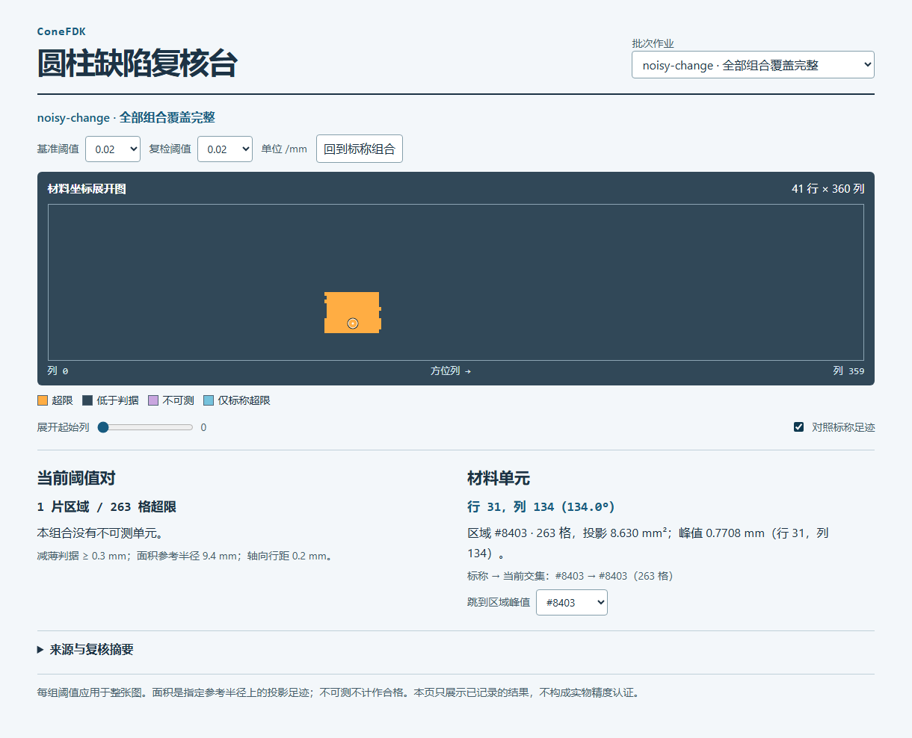

# 离线圆柱复核台

[五条作业的单文件 HTML](region-console.html) · [两种新模拟工件的单文件 HTML](specimen-console.html)。从 GitHub 下载文件后用本机浏览器打开；不需要服务器、Python、CUDA 或联网。浏览器需要支持本地文件上的 Web Crypto。文件只装标签、区域指标、相交关系和摘要，不含投影或完整壁厚剖面，不能从页面重新做 CT。



**试着复核一个决定：** 在第一份文件选 `noisy-change`，将基准阈值改为 `0.022`、复检改为 `0.018`。此时超限的是 253 格，对比标称的 263 格；勾选“对照标称足迹”可以看到只在标称设置下超限的位置。通过“展开起始列”移动接缝，选中的材料行列不变。点地图或用方向键跨越第 359/0 列；如果区域拆开或合并，右侧给的是相交格数，而不是把相同编号当作相同缺陷。

- `invalid-edge-control` 的一部分阈值对有不可测射线。紫色不可测优先于标称叠加，不能当成零减薄。`slide` 和 `missing-reference` 是上游拒测，切换过去不会显示上一件的图。
- 当前格能读出所属区域、**区域**的峰值及材料坐标、面积、接缝与未知区邻接情况；峰值不是光标所在格的连续壁厚读数。图的水平轴是方位，竖直轴是轴向采样行，屏幕宽高不按物理比例显示。
- 导出程序需要可信批索引 SHA-256；核对配方、内容寻址结果、壁图后重新计算标签。浏览器每次换阈值对都复算 int32 小端标签图 SHA-256，坏图不显示。内嵌摘要不能认证同文件中同时遭改写的数据与摘要；传输后由独立渠道核对 HTML 的整文件指纹。

## 从公开壁图自行导出

```powershell
Expand-Archive reports/edge-review-example.zip -DestinationPath build/region-edge-example
python scripts/region_batch.py fixtures/region-offline-batch.json build/console-one-batch
# 本机刚生成且信任的批索引。其它人提供的批次须从独立记录取摘要。
$pin = (Get-FileHash build/console-one-batch/manifest.json -Algorithm SHA256).Hash.ToLowerInvariant()
python scripts/region_console.py fixtures/region-offline-batch.json build/console-one-batch build/console-export --batch-sha256 $pin
```

只写新的目录，成功才发布 `index.html`。原测量限制照常生效；另限每份导出至多 8,192 张图、8,388,608 个配对单元、48 MiB 序列化条目数据。超限应拆批，不会自动降采样。`input_error` 只显示这次批检的错误类型，不泄露本机路径，也不在导出时悄悄重试。

## 浏览器验收

[实际浏览器记录](region-console-browser.json)：本地文件、浏览器断网，22 张图在两个展开位置（标称叠加关/开）与独立留存的 CUDA 行程编码逐像素对照；**44 次绘制、649,440 个 RGBA 像素全部相同**。检查材料坐标选点、不可测优先级、键盘跨缝、拒测无图、小屏不横向溢出和损坏标签拒显。页面没有 HTTP(S) 请求。`scripts/check_region_console.cjs` 是可选的开发验收，需要 Node、Playwright 和本机 Chromium，不是阅读器依赖。
