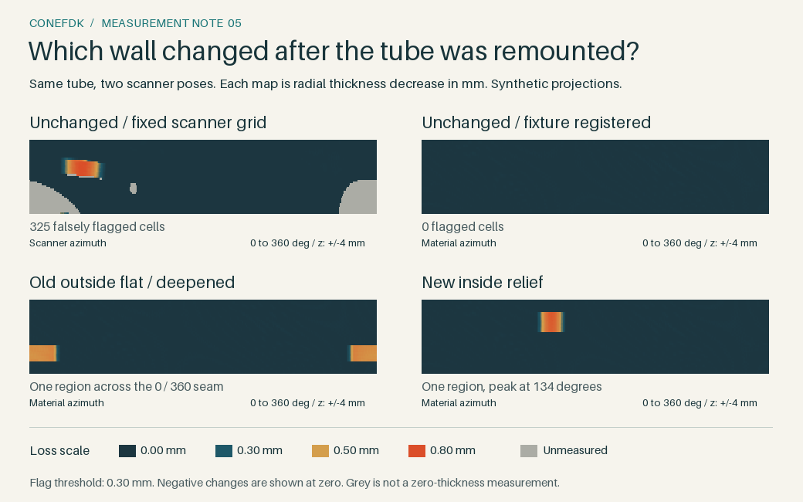

# 换了装夹以后，怎么知道量的还是同一处？

一次投影能量出减薄；两次投影只有对准了**材料上的同一处**，相减才有意义。下面的模拟中，管件本来就有一道外壁平面。把同一个未再加工的管件重新装夹，两次都沿扫描仪固定网格测量，会报出 **325 个超限单元、2 个区域**，另有 1,335 个单元无法比较。用四颗随件球标建立材料坐标再比较，全部 14,760 个单元都有效，没有一个超过 0.30 mm。



## 这次实际测到了什么

两次扫描分别从解析几何生成 **360 张**锥束投影；两次都有偏心装夹、倾斜和轴向位移。生成姿态的外禀 `zyx` 角从 `(-7°, 3°, -4°)` 变到 `(61°, -9°, 7°)`，扫描仪 Z 向平移从 −0.60 变到 +1.10 mm。定位器只读投影、标定球位置和取样配置，不读生成姿态，也不拿缺陷图案去求位移。

| 复扫发生了什么 | 设计值 | 从投影测得 | 足迹交并比（IoU） |
|---|---|---|---:|
| 没有再加工 | 所有位置变化为 0 | 0 区域，逐点最大绝对厚度差 0.03259 mm | — |
| 没有再加工，两次独立计数噪声 | 同上 | 0 区域，最大绝对差 0.03382 mm | — |
| 原外壁平面从 0.85 加深到 1.40 mm | 平面法向**新增 0.550 mm** | 同一法向壁厚减少 **0.54796 mm**；展开图左右两端算作同一区域 | 1.000 |
| 增加一处内壁凹槽 | 峰值 0.750 mm，方位 134° | 0.77072 mm，134°；原外壁平面未被计入 | 0.960 |
| 同一内壁凹槽，两次独立计数噪声 | 同上 | 0.77066 mm，134° | 0.964 |
| 复扫只剩三颗球 | 无有效四球基准 | `datum_rejected`，不生成壁图或减薄报告 | — |

平面的**法向深度**和**径向减薄峰值**不是同一个量。加深例在材料方位 0°、高度 −1.8 mm 核查壁厚变化。单看外表面内退 0.55488 mm；内半径也有 −0.00692 mm 的测量变化，二者合计为上述壁厚减薄量。沿其他方位的射线与平面斜交。按整张网格求径向峰值时，设计是 0.60205 mm，测得 0.61903 mm。三次有变化的比较中，径向峰值最坏误差 0.02072 mm（门槛 0.05 mm）。IoU 比较的是设计和测量在 **0.30 mm** 门槛上的足迹，不是灰度相似度。

在两种装夹和带噪条件下，合格作业最大的旋转误差 **0.01991°**、平移误差 **0.00403 mm**（向上取整）。另取未用于拟合的 72 个材料点：外圆每 15° 一点，在 −4、0、+4 mm 三层上算估计位姿相对设计的坐标偏差，最大 **0.006674 mm**，门槛 0.025 mm。这个量不同于四个球自身的拟合残差，也不是实物测量不确定度。

## 从投影到坐标

1. **找四颗球。** 在小型笛卡尔侦察体中按衰减阈值找 26 邻接域，筛物理体积、边界和三轴方差比，用超阈值灰度的加权质心定位球心。基于探测器高度只重建可能完整看见球的 Z 区间：本例从 160 层降到 **118 层，少写 26.25%**；与完整侦察体直接裁切的 FP32 字节、四个球心均一致。这里没有把输出缩小率当耗时加速比。
2. **解完整刚体位姿。** 校准模板定义材料的原点、轴和零度方向。对四球的 24 种编号分别求不含反射的刚体变换 `scanner = R × material + t`。四球必须非共面；最优匹配中任一球偏差超过配置门槛（示例 0.035 mm），或次优匹配也落在两倍门槛内，都不发布位姿。球体和待测壳层不可相交，两者都必须通过探测器视野检查。
3. **在材料点上重建。** 对每次扫描分别将材料圆柱的中心、轴和接缝变换到该次扫描仪坐标，再从该次的原始投影直接重建壳层。两张壁图的同一行列现在代表同一材料方位和高度。没有对既有壁图做图像配准或插值；原生 `loss` 对输入网格的一致性检查保留。FDK、壁厚和减薄的数值热路径仍是原生 C++/CUDA；侦察体的连通域和四点配准在 CPU 上用 SciPy / NumPy 完成。
4. **留下可复核的证据。** 作业只写新目录，对两次投影、几何、配置和原生程序保持只读锁。`manifest.json` 最后发布，记录输入及产物 SHA-256、定位器版本与源码指纹、观测球心、对应顺序、两个变换和覆盖率。`material-loss.json` 中的 XYZ 属于**材料坐标**；清单另列同一峰点在两次扫描仪中的坐标。这里换算的是同一几何点，不声称两次的外表面半径相同。球标拒测不产生壁图；壁图若仍有未知点，状态为 `incomplete_coverage`，不能当作整段通过。

## 复现与逐点核查

在 Windows 环境按仓库说明安装锁定依赖、从源码构建后，在项目根目录执行：

```powershell
# 从解析射线开始，重做全部带噪/无噪对照、缺标拒测、CPU 标签对照及侦察体字节核对。
# 选一个未用过的工作目录；本例保留投影和全部产物约需 1 GiB。
python scripts/validate_remount.py --keep build/remount-local --reports build/remount-local/reports

# 同一对原始投影，单独运行复检；两个 scan 参数都是不带扩展名的基名。
python scripts/remount_loss.py build/remount-local/scans/reference build/remount-local/scans/deepened fixtures/remount-fixture.json fixtures/remount-material.grid build/check-one --level 0.02 --threshold 0.30 --radius 9.4

# 不装 CUDA 也能查：从原始两条 FP64 壁厚记录重算同一位置，而非抄报告的数字。
python scripts/loss_probe.py bundle reports/remount-deepened.zip --row 11 --column 0
python scripts/loss_probe.py bundle reports/remount-deepened.zip --row 10 --column 336
```

[全部工况与误差](remount-loss.json) · [示例作业清单与变换](remount-example-job.json) · [可逐点核查的壁图包](remount-deepened.zip) · [完整回归及独立重放指纹](remount-regression.json)

**完整回归。** 在独立源码目录用 `Build.ps1 -VerifyRepeat` 连建两次后运行 `Run-Acceptance.ps1 -SkipBuild`（显式传入本机 `-Python` 路径）。239 项测试通过，720 视角核桃的 512³ 体、1296³ 压力体以及旧版找轴、壁厚、孔径与减薄的核查产物保持不变。在另一个新目录从解析投影重跑 `validate_remount.py` 后，可用 `python scripts/check_remount_regression.py <完整验收报告目录> <独立重放报告目录> --out build/remount-check.json` 比对。清单、测量报告、离线壁图包和对照图均逐字节一致。

**适用边界。** 这是受控的有标记复检，不是无标记通用配准。工装与被测件必须始终刚连，模板相对于材料轴线和接缝须事先标定；整套标记相对管件一致滑动，仍可能以很小的球标残差通过。计数噪声使用固定种子和一个光子水平，不包含散射、束硬化、标定漂移、真实装夹公差或工件变形。实测核桃数据只用于验证原重建链未回退，不能代替带外部尺寸真值的实物管件复扫。
