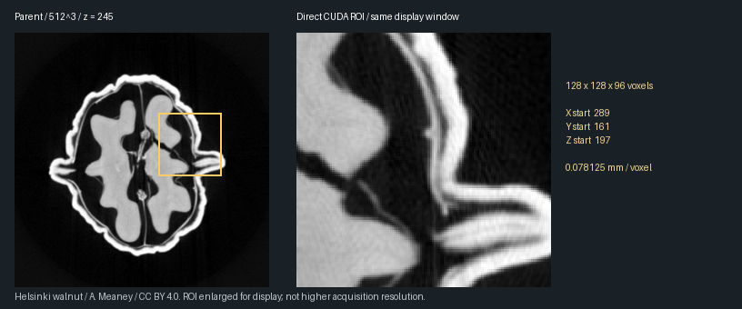

# Direct volume windows / 从原始投影直接重建选区



Left: the box on slice 245. Right: its independently executed CUDA reconstruction, enlarged for display. The two views use the same intensity window. Projections: Alexander Meaney / University of Helsinki, [CC BY 4.0](https://creativecommons.org/licenses/by/4.0/), [dataset](https://doi.org/10.5281/zenodo.6986012); reconstruction, crop, and display scaling by ConeFDK.

## What changes when you select a box?

The engine still reads and filters **all views and detector rows**. Only backprojection, device output storage and disk writes are restricted to the box. Useful when revisiting a known location (a wall, interface, or suspected defect), without generating a large disposable parent file. This is not a reconstruction from truncated detector data and does not locate defects automatically.

`--n` and `--fov` always describe the **parent** cubic grid. `--roi` takes six comma-separated integers: zero-based `x,y,z` and positive `nx,ny,nz`; the end is exclusive. The native output is tightly packed little-endian float32, `[z,y,x]`, X fastest. On all axes the voxel center is `(origin_index + local_index - (n-1)/2) * voxel_spacing_mm`. Do not interpret a window as a new, centered scan. Increasing `n` samples the same projection data more finely; it does **not** improve the detector's physical resolution.

## 两组实测 · Windows GPU

| 同场条件：720 角、40 mm 视野 | 512³ 完整体 | 同一网格内的 128 × 128 × 96 选区 |
|---|---:|---:|
| 整进程中位数（各预热一次，六组交替运行） | 1.561 s | 0.317 s |
| FP32 落盘大小 | 512 MiB | 6 MiB |
| 引擎自有设备缓冲峰值（不含驱动和上下文） | 554.07 MiB | 48.07 MiB |

这里的 **4.93×** 是“只重建所需选区”相比“重建整个 512³ 体”的用时比，不是同等工作量下的内核提速。两条路径均读取同一份投影。六组均核验整个体的发布版 SHA-256，并**逐字节**对比 `(289,161,197)` 起点的选区与整件裁剪。缓存未清空、频率未锁定；不要把此处的完整体基线和旧版 2.009 秒直接做跨版本提速比较。任意参数/批次不承诺位级一致，尤其历史完整体路径在非对齐分块处有浮点舍入差异。

在 **2048³ 参考网格**上另选 `(989,1105,975)` 起始的 **161 × 113 × 79** 区域。若输出完整体需 32 GiB；实际只写出 **5,748,988 字节**，设备缓冲峰值 **47.55 MiB**。ASTRA 在同一体素间距上重建一个更大的、以等中心为中心的 `252 × 388 × 98` 区域，再截取相同物理坐标。选区所有体素的相对 L2 差异为 **0.02447%**（门槛 < 0.1%），未配准、未做强度拟合。没有生成或验证完整 2048³ 体；数值一致性也不等于孔径测量精度。

- [每轮 JSON、数据与二进制 SHA-256](roi-walnut.json) · [生成这些数字的脚本](../scripts/validate_roi.py)
- [1296³ 完整体回归](roi-full-compatibility.json)：此次构建重新写出 8,707,129,344 字节，SHA-256 与 v0.1.0 相同，另用 ASTRA 抽查五层。
- [选区回归测试](../tests/test_roi.py)：奇数尺寸、单体素、贴边、强制多分块、低预算、非法参数、物理坐标与预览尺寸。非对称投影、反向旋转和边界插值还用[独立 FP64 空间域实现](../tests/test_spatial_oracle.py)验证。

## Try it without downloading the full scan

Use a **current source build** and the bundled 90-view fixture. The PowerShell example runs offline after dependency installation. For the exact 720-view demonstration, use `data/full-corrected` from the full acceptance workflow instead of `data/walnut-corrected`.

```powershell
.\Build.ps1
.\Demo.ps1
$py = '.\.venv\Scripts\python.exe'
& $py scripts/reconstruct.py data/walnut-corrected data/window.f32 --n 512 --fov 40 --budget 128 --batch 16 --roi '289,161,197,128,128,96' > data/window.json
if ($LASTEXITCODE) { throw 'ROI reconstruction failed' }
& $py scripts/export_volume.py data/window.f32 --layout data/window.json --out build/window --source-note 'Walnut: A. Meaney / University of Helsinki, CC BY 4.0, doi:10.5281/zenodo.6986012; reconstructed and cropped.'
```

Open `build/window/roi-viewer.html` to scrub the axial previews. Slice labels are indices on the **parent** grid. Use `data/window.mhd` beside `data/window.f32` for quantitative inspection; the header contains the XYZ dimensions, physical spacing and the first voxel's world coordinates. Keep the JSON with its matching raw file: the exporter verifies dimensions/byte count, not dataset identity. The native executable accepts the same `--roi` argument once its GPU DLLs are on `PATH`. Omit `--roi` to use the original complete-volume mode.

**Reproduce the measured gates:** `python -m pytest -q`, then `python scripts/validate_roi.py --scan data/full-corrected` with the pinned 720-view scan. To reproduce the 1296³ compatibility check, run `python scripts/stress.py` after generating `data/phantom` and compare the raw SHA-256 with `reports/run-repeat.json`. The historical v0.1.0 release archive has not been replaced.
