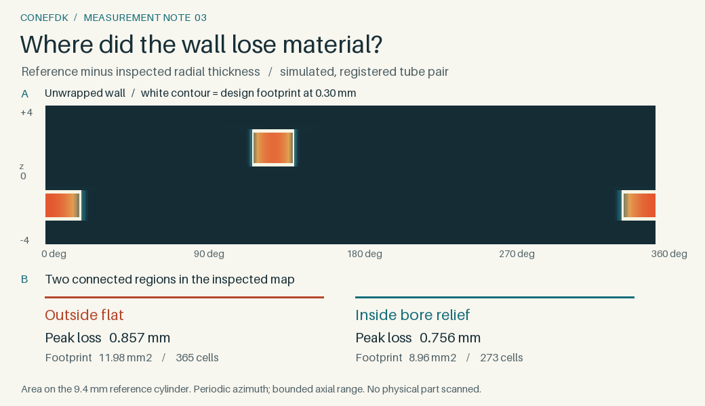

# Local wall loss · 管件局部减薄检测

**What changed on this tube, and where?** `cone-fdk loss` compares radial thickness at matching angles and heights in two registered CT wall maps. A tube can have the correct nominal diameter everywhere except a short flat or an enlarged patch of bore. The report preserves those footprints instead of folding them into a section average.



The white line is the sampled design at the **0.30 mm** threshold. The 0° and 360° edges touch; the first and last axial rows do not. The colored field comes from independently reconstructed wall maps, not from drawing the two tools onto an image.

## Results on one RTX 5060 Laptop GPU

The nominal tube has 9.4 mm outer radius and 6.1 mm bore radius. One removal tool cuts an outside flat around 0°; a second enlarges the bore locally around 134°, at a different height. Detector rays intersect the finite tube, flat half-space and cylindrical tool analytically. The reference and inspected projections go separately through FDK, cylindrical sampling (360 angles × 41 heights × 121 radii), and the existing `wall` command at half contrast. The design footprints use independent radial equations on the same grid. A CPU flood fill also checks every label from the two wall records.

| Dual-surface tube | Design peak | Reported peak | Absolute peak error | Footprint IoU¹ | Area error² |
|---|---:|---:|---:|---:|---:|
| Outside flat, ideal | 0.850 mm | 0.85687 mm | 0.00687 mm | 98.92% | −1.08% |
| Inside relief, ideal | 0.750 mm | 0.75606 mm | 0.00606 mm | 99.27% | −0.73% |
| Outside flat, counting noise | 0.850 mm | 0.85904 mm | 0.00904 mm | 97.83% | −2.17% |
| Inside relief, counting noise | 0.750 mm | 0.76212 mm | 0.01212 mm | 98.55% | −1.45% |

¹ Intersection / union of the above-threshold sampled cells. ² Relative to the cell-count footprint on the 9.4 mm datum cylinder, **not** the machined surface area. The ideal dual-surface peaks both land at the design azimuth. Peak-depth error is not an accuracy bound for every point: maximum absolute error anywhere in the dual-surface map was **0.02150 mm** ideal and **0.02734 mm** noisy.

- **Controls:** the single-flat tube yields one region; a different 0.120 mm shallow flat yields none (maximum observed 0.1220 mm). Two independently noise-sampled pristine scans yield none (maximum observed positive loss 0.0161 mm). Poisson noise is generated on detector counts before the logarithm with 250,000 incident photons per air bin and recorded PCG64 seeds. These are specific tests, not estimates of detection probability or false-alarm rate.
- **Seam:** rotate both reconstruction grids by 90° and reconstruct from the original projections again. Undo the column shift: every FP64 loss value has identical bytes and the full flagged mask matches. Within one frame IDs are invariant to the device budget; grid rotation changes row-major IDs, not the physical defect.
- **Limits declared for qualification:** ideal / noisy minimum IoU 0.90 / 0.88; maximum area error 12% / 14%; maximum peak error 0.070 / 0.085 mm; maximum peak angle error 4° / 6°. Both controls also require exactly zero regions. All are checked, not inferred from the picture.

## Try the actual two-region case

From the checkout, with Python 3.12, **no GPU, NumPy or CT download**:

```powershell
py -3.12 scripts/loss_probe.py bundle reports/wall-loss-demo.zip --row 7 --column 0
py -3.12 scripts/loss_probe.py bundle reports/wall-loss-demo.zip --row 32 --column 134
```

The [small review pack](wall-loss-demo.zip) contains both original wall files, their common grid, the [native JSON](wall-loss-example.json), and member hashes. The tool verifies those hashes and replays the selected cell from two little-endian FP64 records. At row 7 / column 0 the reported loss is 0.856869 mm: **0.856485 mm outside recession** plus **0.000384 mm bore growth**. A point check does not revalidate the original CT reconstruction. Hashes detect changes, not the identity of the specimen.

To run the **native** measurement on the sample (current source build required; not in the historical v0.1.0 executable):

```powershell
Expand-Archive reports/wall-loss-demo.zip -DestinationPath build/loss-example
.\.venv\Scripts\python scripts/loss.py build/loss-example/reference.wall build/loss-example/grid.txt `
  build/loss-example/inspected.wall build/loss-example/grid.txt build/my-regions.json `
  --loss-mm 0.30 --area-radius-mm 9.4 --budget 1
Get-FileHash build/my-regions.json,build/loss-example/regions.json
```

`scripts/loss.py` only locates the native DLLs and runs the binary. With CUDA/cuFFT DLLs already on `PATH`, or for two different source-grid files:

```powershell
.\build\cone-fdk.exe loss --reference baseline.wall --reference-grid baseline.grid `
  --input inspected.wall --cylinder inspected.grid --loss-mm 0.30 --area-radius-mm 9.4 `
  --ptx build/kernels.ptx --budget 16 --output regions.json
```

## Reading `CFDK-loss-v1`

- A cell is flagged exactly when **both** input samples were measured and `reference.thickness − inspected.thickness ≥ threshold`. Negative loss is thickening. Components use four neighbors; a diagonal contact alone does not merge them. No minimum-area filter or interpolation hides isolated cells.
- `runs` contains `[row, first_column, length, code]` in row order. Omitted cells had two valid measurements below threshold. A positive code is the region ID, one plus its smallest row-major index. For an unknown cell, `-2 − code = 7 × reference_status + inspected_status`, using the `wall` status order `measured, empty, clipped, multiple, ambiguous, nonfinite, undersampled`. Unknown runs never join a component. Always check `coverage.unknown`: an empty region list is **not** a pass if nothing was measurable.
- `area_mm2 = cells × (2π × area_radius_mm / columns) × axial_pitch_mm`. `axial_extent_mm` counts full cells including the two end half-cells. `touches_axial_edge` and `touches_unknown` flag a possibly truncated region. `crosses_seam` requires an actual connected 0° edge, not just a wide bounding box.
- `peak` is the cell with the largest loss; ties go to the smallest row-major index. Its world point is on the **inspected outer surface**. `inner_growth_mm` and `outer_recession_mm` are signed and only describe this point. `min_remaining_mm` is the smallest inspected radial thickness **anywhere in that region**; it need not be at the peak. The algorithm does not infer the cause of the change.

## Scaling and independent replay

CUDA evaluates the FP64 loss threshold and connects cells inside each axial tile. C++ stitches only the touching tile rows, keeps the component with the smallest index as the representative, then rereads the wall files for row-ordered region statistics. The GPU budget includes allocation guards, not the driver, host RAM or report size. Host storage includes one 32-bit label per cell and one statistics entry per reported region; a fragmented map can produce a large report. The original wall maps remain read-locked during both passes; invalid input never replaces the output file.

The [wide-map test](wall-loss-scale.json) uses **4,096 × 1,024 cells**, 256 MiB for the input pair. Its two known regions exercise the seam, tile boundaries, axial ends and a missing measurement. It compares every output label to a closed-form footprint. With a 1 MiB device budget the inspector used 837,120 owned bytes in 342 tiles; with 16 MiB it needed 18 tiles. Both wrote identical JSON. This test measures capacity and stability, not X-ray accuracy or throughput.

```powershell
# From fresh analytic detector projections; keep scans, intermediate maps and native output.
.\.venv\Scripts\python scripts/validate_loss.py --keep build/loss-data --reports build/loss-evidence
# Check another point directly in your own maps, on a CPU:
py -3.12 scripts/loss_probe.py raw build/my-regions.json build/loss-example/reference.wall `
  build/loss-example/inspected.wall --row 20 --column 90
```

Two clean builds produced matching EXE/PTX hashes. All **195 tests** passed (0 skipped). A second run regenerated the scans, reports, PNG and review pack independently; their loss evidence hashes matched. The full acceptance run also reproduced the previously published 512³ walnut, 1,296³ stress volume, ROI, plane, cylinder, wall and bore payloads.

[Qualification metrics, gates and input/output hashes](wall-loss.json) · [Build, independent replay and legacy regression](wall-loss-regression.json) · [JUnit](wall-loss-tests.xml) · [Native inspector](../src/loss.hpp) · [Projection generator](../scripts/loss_phantom.py)

**适用边界：** 两次扫描必须在同一物理坐标系，且上游应使用可比的标定和界面阈值。程序会核对两份圆柱网格，但相同描述文件不能证明零件没动，也不能证明无头 `.wall` 文件一定配对正确。没有自动配准。这里测的是沿采样半径的厚度变化，不是表面法向距离；这里的面积是投影到指定半径圆柱上的采样面积。本轮没有实物标准件、跨机台重复性或工业验收认证。要判断实际磨损，应以带独立测量真值和重复装夹记录的试件验证。
